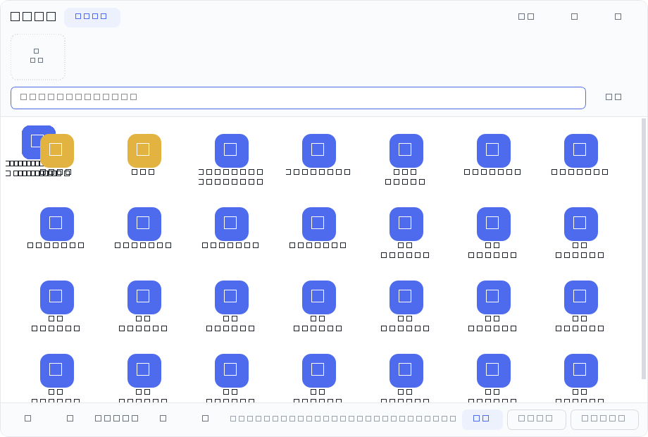

# 桌面收纳美化工具 · Desktop Nest

一个 Windows 桌面小工具，三件事：

1. **启动程序时自动把桌面收干净**——个人桌面 + 公共桌面上的文件、文件夹、快捷方式，连「此电脑」「回收站」这类系统图标一起收进隐藏目录，桌面彻底空白
2. **屏幕底部正中给一条仿 macOS 菜单栏**，第一个控件就能分页浏览、搜索、打开收纳起来的东西
3. **退出程序时自动还原**，桌面回到你熟悉的样子

技术栈：**Python + PyQt6**（Win10 / Win11）。纯本地运行，不联网、不装服务、不上传任何东西。


---

## 快速开始

```
1. 双击  安装依赖.bat        （只需一次，装上 PyQt6）
2. 双击  创建快捷方式.bat     （可选：在桌面和开始菜单放一个带图标的快捷方式）
3. 双击  启动桌面收纳.bat     或双击桌面上的「桌面收纳」
```

> **关于 .exe**：程序是 Python 写的。想要一个真正的单文件 `.exe`，需要用
> PyInstaller 打包（见文末「打包成 exe」）。`创建快捷方式.bat` 提供的是**体验等价**的方案：
> 带图标、带名字、双击即启动、**不弹黑窗口**（走 `pythonw.exe`），
> 在开始菜单里还能搜索并固定到任务栏。

启动后会看到：
* 屏幕底部正中一条**菜单栏**
* 一个主面板（只在第一次运行时显示，之后静默驻留托盘）
* 桌面上的东西已经被收进收纳目录，桌面空了

> **个人桌面和公共桌面会一起收**。公共桌面
> （`C:\Users\Public\Desktop`）里的快捷方式会显示在**所有用户**的桌面上，
> 只收个人桌面是收不干净的，所以两个都收；还原时各自送回原处。

托盘图标在任务栏右下角（抽屉形状，可能被折叠进「^」溢出区）。
**左键单击** = 开关收纳面板；**双击** = 打开主面板。

---

## 底部菜单栏（Dock）

```
┌────────────────────────────────────────────────────────────┐
│ ◀ │ 此电脑  回收站  资料夹  报告.docx …（一页 7 个）│ ▶ │ 1/6 │  ← 分页行
├────────────────────────────────────────────────────────────┤
│ [▣ 桌面整理] │ [微][S][E]…  ＋  ▼   ⚙   ✕                  │  ← 主行
└────────────────────────────────────────────────────────────┘
```

| 位置 | 操作 |
| --- | --- |
| **分页行** | 每页 7 个，**快捷方式图标 + 下方名称**；点一下直接打开；`◀ ▶` 翻页，右侧显示 `当前页/总页数` |
| **第一个控件「桌面整理」** | 打开完整的收纳面板（分页 + 搜索 + 还原） |
| 主行的常用启动项 | 图标 + 名称，单击直接启动 |
| `＋` | 从收纳内容里选、或浏览文件，加进常用启动 |
| `▼` / `▲` | **收起 / 展开上面那排分页行**（菜单栏变矮，只剩常用启动那一行）。状态会记住 |
| `⚙` | 打开设置 |
| `✕` | **隐藏整条菜单栏**。隐藏后从托盘右键菜单勾选「显示底部菜单栏」就能叫回来 |
| 空白处拖动 | 整条菜单栏左右移动，位置记住 |
| 空白处右键 | 收起分页行 / 图标大小 / 总在最前 / 全部还原到桌面 / 打开主面板 / 设置 / 退出 |

> 隐藏整条菜单栏之后程序不会退：托盘图标仍在，右键菜单里能勾回来。
> 这两个开关的状态都存进配置，重启后保持你上次的选择。

---

## 收纳面板（点「桌面整理」）



* **图标 + 下方名称**的网格显示
* **分页**：默认 7 列 × 4 行 = 28 个/页，底部 `⏮ ‹ 1/2 › ⏭`；也支持 `PageUp/PageDown`、`Ctrl+滚轮`
* **搜索**：实时模糊匹配；连续命中（如搜「文件0」→「文件00」）永远排在顺序命中（→「文件20」）前面
* 每页数量可调 14 / 21 / 28 / 35 / 42
* 顶部一排是**常用启动**（图标 + 名称），可加可删
* 选中后可「打开」「加为常用」「还原到桌面」；右键还有打开所在位置、复制路径、查看文件夹大小

---

## 底部菜单栏的行为细节

| 行为 | 说明 |
| --- | --- |
| **收起 / 展开分页行** | 点 `▼` / `▲`，菜单栏高度**立刻跟着变**（不留空白） |
| **隐藏整条菜单栏** | 点 `✕`。这是"用户主动隐藏"，之后**不会**自动弹回来——尊重你的选择 |
| **回到桌面自动显示** | 切回桌面时菜单栏自己出来。托盘右键可关掉这项 |
| **最大化/全屏时让开** | 前台窗口最大化（浏览器、资源管理器）或全屏（看视频、演示）时自动收起，**不遮挡内容**；还原窗口后再回来 |
| **常用项多了会换行** | 加再多常用启动也只会让菜单栏变宽变高到屏幕能容纳的程度，**永远不会跑出屏幕**，图标也不会被挤扁 |
| **面板不置顶** | 收纳面板不会永远压在别的程序上面；点别的窗口它就正常让到后面 |

> 这几条的区别很重要：**自动显隐只在"你没主动关过"的前提下生效**。
> 你点过 `✕` 之后，程序不会自说自话把它弹回来——要用托盘菜单或
> 「回到桌面自动显示菜单栏」开关重新打开。

---

## 收纳行为（核心）

```
启动程序                                    退出程序
   │                                          │
   ├─ 个人桌面 ──┐                            ├─ → 个人桌面
   ├─ 公共桌面 ──┴─→ 收纳目录                 ├─ → 公共桌面（各回各家）
   ├─ 隐藏桌面图标（桌面彻底空白）              ├─ 恢复桌面图标
   └─ 建 此电脑/回收站 等系统快捷方式           └─ 收纳目录清空
```

三件事都在设置里可以单独关掉。

### 文件夹是整体搬走的

桌面上的**文件夹作为一个整体**进收纳目录，里面内容原样保留，不会拆到顶层：

```
整理前桌面                     收纳后
├── 单片机入门资料/      →     ├── 单片机入门资料/
│   ├── 第一章/                  │   ├── 第一章/
│   │   └── 笔记.txt             │   │   └── 笔记.txt
│   └── 说明.txt                 │   └── 说明.txt
└── 报告.docx            →     └── 报告.docx
```

### 公共桌面也会一起收

`C:\Users\Public\Desktop` 里的快捷方式会显示在**所有用户**的桌面上。
只收个人桌面的话，这一批会一直留在桌面上，所以两个桌面都收：

| 情况 | 处理 |
| --- | --- |
| 公共桌面的快捷方式 | 一并收进收纳面板，**还原时送回公共桌面**（不会挪到你个人桌面） |
| 两边同名的（如都有 `记事本.lnk`） | 公共那份收进来时加后缀 `记事本（公用）.lnk`，避免互相覆盖；还原时自动去掉后缀 |
| 公共桌面没写权限 | 那个条目会**退回个人桌面**并在结果里说明，不会把文件卡住或弄丢 |
| 缺失 `desktop.ini` | 系统文件，始终跳过 |

> 注意：写入 `C:\Users\Public\Desktop` 有时需要管理员权限。如果你的账号没有，
> 收纳这一步会失败并被记录下来，**文件不会丢**——程序会明确告诉你哪些没成功。
### 「此电脑」「回收站」也会被收进去

这两个不是文件系统里的东西（没有路径），程序用 Windows 的 `IShellLinkW` 接口生成
指向 `::{CLSID}` 的快捷方式放进收纳目录，于是在面板里能看到、能点开，
桌面本身则一个图标都不剩。生成的是标准快捷方式，双击由资源管理器打开。

### 收纳目录在哪

```
C:\Users\<你>\.desktop-nest\
├── desktop\      ← 两个桌面上原来的东西
├── links\        ← 此电脑 / 回收站 / 网络 / 用户文件夹 的快捷方式
├── links.json    ← 名称 → shell 位置的对照表
└── sources.json  ← 每个条目原来在个人桌面还是公共桌面（决定还原去哪）
```

是隐藏目录，平时不用管。想看看就点主面板的「打开收纳目录」。

---

## 搜索

置顶搜索框，输入即时过滤：

* **连续子串优先**（含前缀）：搜「报告」命中「季度报告.docx」
* **顺序匹配兜底**：搜 `gch` 也能命中 `Google Chrome`，但**永远排在连续命中之后**
* 结果自动收拢到一页
* 清空（点「清空」或按 `Esc`）立刻恢复全部

---

## 安全设计

| 机制 | 说明 |
| --- | --- |
| **只移动，绝不删除** | 全程没有任何删除文件的代码路径 |
| **绝不覆盖** | 目标重名自动加 `(1)`、`(2)` 后缀 |
| **跨盘安全搬运** | 同分区用 `os.replace`（原子改名）；跨分区改为「复制 → 校验大小 → 删源」，最坏情况是留下重复文件，不会丢文件 |
| **系统项保护** | `desktop.ini`、`Thumbs.db`、隐藏文件、`~$` 临时文件、`.crdownload` 半成品一律不动 |
| **失败可解释** | 被独占占用时预判为跳过并说明原因；只读文件正常收纳、不会误判 |
| **退出必还原** | 即使异常退出，下次启动也会先把上次没收完的还原回去 |
| **全程可撤销** | 每次操作写 JSONL 流水，主面板「操作历史」里可整批撤销 |

---

## 边界与异常处理

| 情况 | 表现 |
| --- | --- |
| 文件被独占占用 | 标为跳过并说明原因，不强行搬 |
| 只读文件 | 照常收纳（不会误报成"被占用"） |
| 权限被拒 | 提示「所在文件夹不可写（可能需要管理员权限）」 |
| 收纳目录不可写 | 自动退到程序目录下的 `.desktop-nest` |
| 隐藏桌面图标失败 | 记日志，不影响收纳本身，仍可手动在桌面右键切换 |
| 快捷方式解析失败 | 退回显示 Shell 类型图标，不报错、不崩溃 |
| 开机自启写不进去 | 自动改用「开始菜单 → 启动」文件夹；都失败则提示手动方式 |
| 意外异常 | 后台线程兜底捕获 + 写日志到 `.data\app.log` |

---

## 文件结构

```
desktop-nest\
├── 启动桌面收纳.bat        启动器（自动挑一个能用的 Python）
├── 创建快捷方式.bat        在桌面/开始菜单放一个带图标的快捷方式
├── 还原桌面.bat            应急：把收纳目录里的东西全部搬回桌面
├── 修复公共桌面.bat        把公共桌面的快捷方式送回去（需管理员）
├── 安装依赖.bat            一键安装 PyQt6
├── create_shortcut.py      上面那个快捷方式脚本的实现
├── restore_desktop.py      应急还原的实现
├── fix_public_desktop.py   公共桌面修复的实现
├── app.ico                 程序图标（快捷方式/打包都用它）
├── main.py                 入口
├── tray_app.py             托盘常驻 / 启动收纳 / 退出还原 / 后台扫描
├── nest.py                 收纳目录管理：搬运、系统位置快捷方式、图标开关
├── winlink.py              .lnk 创建与解析（COM IShellLinkW，虚表下标实测过）
├── dock.py                 底部菜单栏（含内嵌分页行）
├── desktop_browser.py      收纳面板（分页网格 + 搜索 + 常用启动行）
├── panel.py                主面板（统计卡片 + 内容列表 + 历史）
├── settings.py             设置窗口
├── engine.py               条目类型、图标解析、日志流水
├── safety.py               安全校验：系统项、占用、路径
├── icons.py                Windows Shell 图标提取 + 缓存
├── textutil.py             模糊搜索与高亮区间
├── widgets.py              共用的图标加载器
├── theme.py                配色与整份 QSS
├── qt_compat.py            Qt 加载器（自带 libs 优先）
├── setup_libs.py           直接下载解包 PyQt6（pip 不可用时的备用方案）
├── libs\                   自带 Qt 运行库（约 207 MB，可删）
├── dev\                    自检脚本
└── .data\                  运行期数据：config.json / journal.jsonl / app.log
```

### 关于 `libs\` 这 207 MB

里面是 PyQt6 + Qt6 运行库。留着换台机器、换个 Python 都能直接跑；
想省空间可以删掉，再跑一次 `安装依赖.bat` 把 PyQt6 装进系统 Python。

---

## 快捷键

| 位置 | 按键 | 作用 |
| --- | --- | --- |
| 收纳面板 | `Ctrl+F` | 聚焦搜索框 |
| 收纳面板 | `Esc` | 有搜索词时清空；否则隐藏窗口 |
| 收纳面板 | `← →` | 在图标间移动 |
| 收纳面板 | `Enter` | 打开选中项 |
| 收纳面板 | `PageUp / PageDown` | 翻页 |
| 收纳面板 | `Ctrl+滚轮` | 翻页 |
| 托盘图标 | 左键单击 / 双击 | 开关收纳面板 / 打开主面板 |

---

## 高分屏 / 显示效果

程序按下面几点保证在 125% / 150% 缩放的屏幕上显示正常：

* 字体用 **pt（点）** 而不是 px —— 像素字号不随系统 DPI 缩放，
  结果就是别的东西都变大了、只有文字还是那么小
* 图标按控件实际的 `devicePixelRatio` 请求物理像素再缩回来，
  避免直接放大导致发虚
* 窗口图标提供 16 ~ 256 共 7 种尺寸，小图标位上也不会糊

> 如果看着还是偏小或偏大，可以在「设置 → 外观与启动」里调图标大小；
> 字体跟随系统缩放，不用额外设定。

---

## 应急还原（万一桌面上什么都没了）

正常情况下退出程序就会自动还原。如果程序被强制结束、或者你不放心，
项目里有三个现成的工具：

| 工具 | 用途 |
| --- | --- |
| `还原桌面.bat` | **双击即可**。把收纳目录里的东西全部搬回桌面，公共桌面的送回公共桌面 |
| `重启程序.bat`（即 `启动桌面收纳.bat`） | 程序启动时会先 `recover_leftovers()` 把上次残留还原，再重新收纳 |
| `修复公共桌面.bat` | 如果公共桌面的快捷方式落在了个人桌面，**右键以管理员身份运行**送回去 |

收纳目录固定在：

```
C:\Users\<你>\.desktop-nest\desktop     ← 你的文件都在这（找不到就从程序目录找）
```

这两个脚本都**只移动、不删除**，重名自动加序号。任何时候都可以直接去这个目录
把文件手动拷回来——它是普通文件夹，程序只是负责搬运。
## 打包成 exe

程序本身是 Python，要真正的单文件 `.exe` 需要在**你自己的机器上**打包一次
（我这边受限，装不上 PyInstaller）：

```bat
:: 1. 装打包工具
python -m pip install pyinstaller

:: 2. 在项目目录里打包（--noconsole 保证不弹黑窗口）
pyinstaller --noconsole --onefile --name "桌面收纳" ^
    --icon app.ico ^
    --add-data "libs;libs" ^
    main.py
```

几点提醒：

* **产物会很大**（100 MB 以上），因为要把 Qt6 整个塞进去。想瘦身可以用
  `--onedir` 代替 `--onefile`，启动也更快。
* `app.ico` 已经生成好了，可以直接用；想换图标替换这个文件即可。
* 打包后第一次运行请**先在沙盒目录里试一遍**（设置里把桌面指到临时目录），
  确认收纳 / 还原都正常再正式用。
* 打包版和脚本版**共用同一份配置**（`~\.desktop-nest\` 与 `.data\`），可以随时互换。
## 开发者：自检脚本

```bat
python dev\test_core.py          :: 快捷方式 COM / 安全校验 / 模糊搜索（46 项）
python dev\test_move.py          :: 搬运安全性与失败回滚（13 项）
python dev\test_icons_page.py    :: 翻页后图标不消失（回归 11 项）
python dev\test_dock_fixes.py    :: 启动崩溃 / 常用图标 / 高亮 / 底栏尺寸 / 显隐 / 不遮挡（27 项）
python dev\test_round3.py        :: 常用图标 / 不跑出屏幕 / 窗口图标 / DPI 字体 / 让开判据（23 项）
python dev\test_nest.py --shots  :: 收纳主流程 / 两个桌面 / 分页 / 底栏开关 / 启动收纳退出还原（89 项）
```

六套共 **209 项检查**，都只在临时沙盒目录里操作，**不会碰真实桌面**。
`--shots` 会把界面截图存到 `shots\`。

辅助脚本（排查用）：

```bat
python winlink.py                  :: 实机验证快捷方式创建与解析
python dev\probe_vtable.py         :: 实测 IShellLinkW 虚表下标（用官方 COM 对账）
python dev\probe_getargs.py        :: 排查读取参数的下标
```

### 关于 COM 虚表下标（不要凭记忆猜）

`IShellLinkW` 的虚表顺序猜错不会报错，只会静默把数据写到别的属性上
（开发过程中就出现过"说明"被写进"参数"、生成一堆怪快捷方式的问题）。
所以这些下标都是**实测**出来的，验证方式见 `dev\probe_vtable.py`：
逐个下标写标记值，再用 Windows 官方的 `WScript.Shell` 读回来对账。

另外，`IShellLinkW::GetArguments` 在 ctypes 直连虚表时返回 `E_INVALIDARG`（写入侧正常、
官方 COM 也能读到），所以程序**不依赖**读取参数来判断系统位置，改用自己维护的
`links.json` 清单——见 `nest.shell_path_for()`。

---

## 已知边界

* **系统托盘**：如果系统禁用了通知区域，程序会记日志并直接显示主面板。
* **开机自启**：写的是当前用户的 `HKCU\...\Run`（不需要管理员）。被安全软件拦截时会改用「启动」文件夹。
* **隐藏桌面图标**：走的是 Explorer 的 `HideIcons` 设置，等同桌面右键「查看 → 显示桌面图标」。
* **指向商店应用（UWP）的快捷方式**没有普通文件路径，会退回显示类型图标。
* 收纳目录**不能设在桌面里面**，程序会主动拒绝——否则会自己搬自己。
