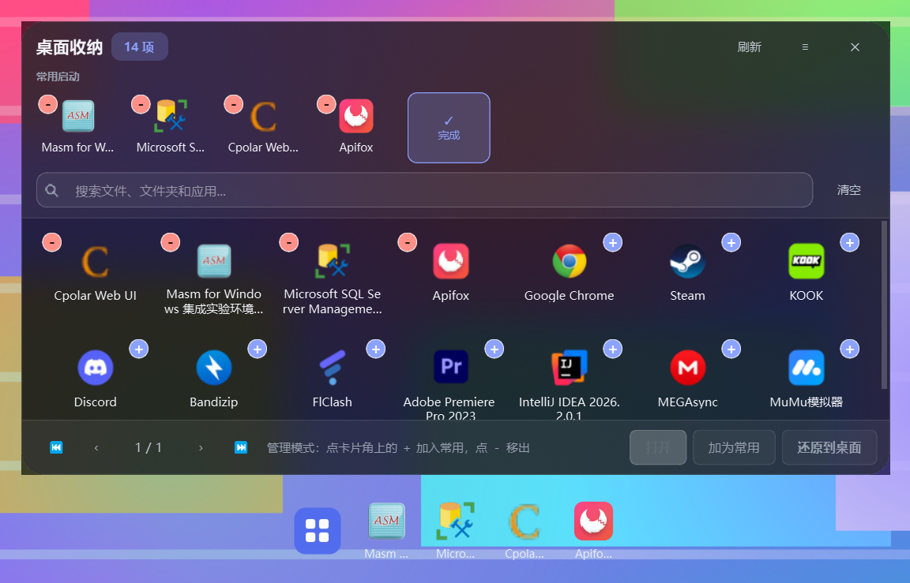

# 桌面收纳美化工具 · Desktop Nest

一个 Windows 桌面小工具，三件事：

1. **启动程序时自动把桌面收干净**——个人桌面 + 公共桌面上的文件、文件夹、快捷方式，连「此电脑」「回收站」这类系统图标一起收进隐藏目录，桌面彻底空白
2. **屏幕底部正中给一条仿 macOS 菜单栏**，点最左边的「桌面整理」就向上拉出一块**磨砂玻璃浮层**，分页浏览、搜索、打开收纳起来的东西
3. **退出程序时自动还原**，桌面回到你熟悉的样子

技术栈：**Python + PyQt6**（Win10 / Win11）。纯本地运行，不联网、不装服务、不上传任何东西。

> **换电脑 / 第一次部署 / 想知道数据存在哪**：看
> **[使用与迁移指南.md](使用与迁移指南.md)** —— 环境要求、三步上手、
> 迁移清单（哪些要拷、哪些别拷）、数据位置表、常见问题、卸载还原都在里面。

---

## 快速开始

```
1. 双击  安装依赖.bat        （只需一次，装上 PyQt6）
2. 双击  创建快捷方式.bat     （可选：在桌面和开始菜单放一个带图标的快捷方式）
3. 双击  启动桌面收纳.bat     或双击桌面上的「桌面收纳」
```

> **关于 .exe**：程序是 Python 写的。想要一个真正的单文件 `.exe`，需要用
> PyInstaller 打包（见文末「打包成 exe」）。`创建快捷方式.bat` 提供的是**体验等价**的方案：
> 带图标、带名字、双击即启动、**不弹黑窗口**（走 `pythonw.exe`），
> 在开始菜单里还能搜索并固定到任务栏。

启动后会看到：
* 屏幕底部正中一条**菜单栏**
* 一个主面板（只在第一次运行时显示，之后静默驻留托盘）
* 桌面上的东西已经被收进收纳目录，桌面空了

> **个人桌面和公共桌面会一起收**。公共桌面
> （`C:\Users\Public\Desktop`）里的快捷方式会显示在**所有用户**的桌面上，
> 只收个人桌面是收不干净的，所以两个都收；还原时各自送回原处。

托盘图标在任务栏右下角（抽屉形状，可能被折叠进「^」溢出区）。
**左键单击** = 开关收纳面板；**双击** = 打开主面板。

---

## 视觉系统（Design Token）

所有界面（主面板 / 收纳面板 / 设置窗 / Dock / 右键菜单）共用**同一份**样式表，
由 `theme.py` 里的 Design Token 统一生成。没有第二套颜色体系，也没有哪个窗口
自己写一段 QSS 另起炉灶。

### 三层结构

| 层 | 在哪 | 作用 |
| --- | --- | --- |
| **语义色彩 Token** | `theme.COLOR_TOKENS` | 颜色只按用途命名，浅色 / 深色 / 玻璃各一套值 |
| **尺度 Token** | `RADIUS` / `SHADOW` / `CONTROL` / `FONT_SIZE` / `FONT_WEIGHT` / `DURATION` / `EASING` | 圆角、阴影、控件高度、字号字重、动画时长 |
| **扁平色板** | `LIGHT` / `DARK` / `GLASS` | 由第 1 层展开，**保留历史短名**（`accent` / `text_sub` / `hover` …） |

想换配色只动 `COLOR_TOKENS` 一张表；想改圆角只动 `RADIUS`；
老代码读的 `theme.LIGHT["accent"]` 这类短名照旧能用，不用改一行。

### 色彩 Token 一览

| Token | 用途 | 浅色 | 深色 | 玻璃 |
| --- | --- | --- | --- | --- |
| `bg` | 窗口底 | `#F5F6F8` | `#17191E` | `#181A20` |
| `surface` | 卡片 / 控件底 | `#FFFFFF` | `#1F2228` | `rgba(255,255,255,.06)` |
| `surface_hover` | 悬停底 | `#F1F3F7` | `#2A2E36` | `rgba(255,255,255,.10)` |
| `border` | 常规描边 | `#E6E8EC` | `#2E323A` | `rgba(255,255,255,.10)` |
| `border_strong` | 控件描边 | `#D7DAE0` | `#3B414B` | `rgba(255,255,255,.20)` |
| `text_primary` | 正文 | `#1D2129` | `#E9EBEF` | `#F3F5F9` |
| `text_secondary` | 次要文字 | `#6B7280` | `#9CA3AF` | `#C3CAD6` |
| `text_muted` | 弱化 / 占位 | `#9AA1AC` | `#6F7681` | `#98A1B0` |
| `primary` | 品牌蓝紫 | `#4F6BED` | `#7089FF` | `#8CA2FF` |
| `primary_hover` | 主色悬停 | `#6180F5` | `#8399FF` | `#A0B2FF` |
| `success` | 成功 | `#12A150` | `#35C97E` | `#4FD695` |
| `warning` | 警告 | `#C77700` | `#E0A33F` | `#F2BC6A` |
| `danger` | 危险 / 删除 | `#D93025` | `#F2685F` | `#FF9088` |

（完整表可以直接跑 `theme.token_table()` 打出来，不用手工同步。）

### 尺度 Token

* **圆角** `RADIUS`：`xs 4 → sm 6 → md 7 → lg 10 → xl 12 → popup 16 → dock 18 → card 22`。
  按钮/输入框用 `md`，卡片/列表用 `lg`，玻璃卡片用 `card`。历史别名
  `RADIUS_SMALL`（=7）和 `GLASS_RADIUS`（=22）还在。
* **阴影** `SHADOW`：`sm / md / lg` 三档（`blur / dx / dy / alpha`）。
  ⚠️ QSS **没有** `box-shadow`，所以阴影走 `theme.drop_shadow(widget, "md")`
  → `QGraphicsDropShadowEffect`，参数统一从 token 取。
* **控件高度** `CONTROL`：按钮 / 输入框 / 下拉框共用 `min_height: 20px` +
  `padding: 7px` + `1px` 边框 = **36px**，三者自然高度**完全一致**。
* **字号** `FONT_SIZE`：`xs 8.25 → sm 9 → base 9.75 → md 11 → close 11.25 →
  lg 12.75 → xl 16.5`（**全部 pt**，跟随系统 DPI）。
* **字重** `FONT_WEIGHT`：`regular 400 / medium 500 / semibold 600 / bold 700`。
* **动画时长** `DURATION`：`fast 120 / normal 180 / slow 260 / settle 60 /
  tick 16 / highlight 1200`（毫秒）。Qt 的 QSS 没有 `transition`，这些值给
  代码里的 `QTimer` 用；弹簧本身的手感在 `springs.py`。

### 统一的组件

| 组件 | 选择器 | 三态 |
| --- | --- | --- |
| Button | `QPushButton` + `#Primary` / `#Soft` / `#Warning` / `#Danger` / `#Ghost` / `QToolButton` / `#Toolbar > QToolButton` | hover / pressed / **focus** / disabled |
| Input | `QLineEdit` / `QTextEdit` / `QComboBox` / `#Search` | focus / hover / disabled |
| Checkbox | `QCheckBox::indicator` | hover / checked / disabled |
| Tab | `QTabBar::tab` / `QTabWidget::pane` | hover / selected / disabled |
| Card | `#Card` / `#Panel` / `#MainCard` | — |
| Tooltip | `QToolTip` | — |
| Toast | `#Toast` / `#ToastOk` / `#ToastWarn` / `#ToastDanger` | — |
| Dialog | `QMessageBox` / `QMessageBox QLabel` / `QMessageBox QPushButton` | — |
| Menu | `QMenu` / `QMenu::item` / `QMenu::separator` | selected / disabled |

Tooltip 和 Toast 共用一套"反色药丸"配色（`toast_bg` / `toast_text`），
浅色主题下是深底浅字，深色 / 玻璃下是深灰底浅字，两种主题都够醒目。

### 设计方向（不要改）

深色 / 半透明 / 圆角 / 蓝紫强调 ——「现代 Windows 桌面工具」，
克制、高级、安静。**不做**赛博朋克、游戏 UI、大面积霓虹、过度玻璃与渐变。

### 改样式时要注意的三件事

1. **玻璃规则块必须留在样式表最后**。放在中间的话，后面那些
   `#Popup { background: … }` 之类的普通规则会把玻璃规则盖掉 ——
   玻璃看起来"没生效"，其实是被后写的规则赢了。
2. **字号一律用 pt**，不要写 px（`test_round3` 和 `test_theme_tokens` 都会拦）。
   px 字号在高 DPI 屏上不跟着缩放，字会小一圈。
3. **不要在界面文件里另写色号 / 圆角 / 时长**。都从 `theme` 取，
   `test_theme_tokens.py` 第 10 节会扫描 `dock.py` / `desktop_browser.py` /
   `widgets.py`，发现残留的硬编码就报错。
4. **顶栏图标钮的选择器必须写成子选择器** `#Toolbar > QToolButton`，
   **不能**写成后代选择器 `#Toolbar QToolButton`。后者的特异性 (1,0,1)
   高于 `#AppManage` (1,0,0)，会把"管理"控件那条虚线描边整条盖掉。
   （"管理"挂在 `apps_host` 下面，用 `>` 天然把它排除在外。）
5. **卡片的选中 / 悬停只能走动态属性**，别用 `widget.setStyleSheet()`。
   内联样式表的特异性高于全局规则，贴上之后 `#FileTile:hover` 就永远不生效
   —— 症状是"卡片悬停没有任何反应"。正确写法见 `ItemTile._apply_style()`。

---

## 主面板的信息层级（Phase 2）

主面板（`desktop_browser.DesktopBrowser`）的结构没变，改的是**层级**：

| 位置 | 谁是主要信息 | 谁是次级操作 |
| --- | --- | --- |
| 顶部 | 标题「桌面收纳」+ 数量徽标 | 刷新 / ≡ / ✕（常态透明、淡色，悬停才浮出来） |
| 常用启动 | 「常用启动」小标题 + 图标 | 「管理」开关（虚线描边） |
| 搜索 | Placeholder「搜索文件、文件夹和应用...」 | 「清空」 |
| 网格 | 卡片本身（图标 + 名称） | — |
| 底部 | 「打开」= `#Primary` 实心主色 | 「加为常用」= 默认描边 / 「还原到桌面」= `#Warning` 暖色 |

几条容易踩的：

* **常用启动的悬停是"轻微放大图标"**，比例写在 `APP_HOVER_SCALE = 1.12`
  （需求要求不超过 1.15）。QSS 没有 `transform`，所以用
  `QPropertyAnimation` 动 `iconSize`；按钮是固定尺寸的，变大的只有图标，
  整排不会重新排版。
* **网格卡片的名称是两行 + 末尾省略号**，实现是 `widgets.ElidedLabel`
  （自己画字），但 `text()` 仍然是**完整**显示名 —— 别处和自检都按它比对。
* **图标统一大小**靠 `pixmap_for(..., square=True)`：把任意长宽比的图标
  等比居中放进 `GRID_ICON × GRID_ICON` 的方形画布，否则扁文件夹会比
  竖文档显得大一圈。
* **搜索框左侧的放大镜**是 `QLineEdit.addAction(LeadingPosition)`，
  Qt 会自己把文字让开，所以样式表里**不能**再写 `padding-left`
  （写了会在图标和文字之间多留一段谁也看不见的空档）。
* **主面板（`panel.MainPanel`）的两个按钮跟着数量灰掉**：桌面待收纳 = 0
  时「收纳桌面」disabled，收纳项目 = 0 时「还原桌面」disabled
  （见 `refresh_cards()`）。

---

## 底部菜单栏（Dock）


```
   没加常用软件时：  [▣ 桌面整理]
   加了常用软件后：  [▣ 桌面整理] │ [记事本] [文件资源管理器] [计算器]
                    └─────────────── 一行，没有底板，直接浮在桌面上 ───────────────┘
```

**底板是纯透明的**：没有那条深色圆角横条，只有「桌面整理」控件和常用启动图标
浮在桌面上（图标名字用浅色，好在大多数壁纸上看清）。

菜单栏上**只有这两样东西**：第一个控件「桌面整理」+ 常用软件图标。
原来那排"分页条目"整行删掉了，`＋` / `－` / `⚙` / `✕` 四个控制按钮也**全部删掉**了
（分页浏览搬进收纳面板；增删常用软件搬进收纳面板的「管理」控件；
设置和隐藏整条菜单栏搬进托盘右键菜单）。

| 位置 | 操作 |
| --- | --- |
| **第一个控件「桌面整理」** | **上拉 / 收起收纳面板**（分页 + 搜索 + 还原）；再点一次收起，等同托盘左键单击 |
| 常用启动项 | 图标 + 名称，单击直接启动；**长按左键可拖动排序**（见下）；右键出「打开 / 打开所在位置 / 左移 / 右移 / 从菜单栏移除」 |
| **按住拖** | **整条菜单栏沿屏幕底边左右移动**，位置记住（`dock_x`） |
| 空白处右键 | 打开桌面收纳面板 / 全部还原到桌面 / 图标大小 / 总在最前 / 打开主面板 / 设置 / 退出 |

> **原来那四个按钮现在在哪儿？**
>
> | 原来 | 现在 |
> | --- | --- |
> | `＋` 加常用 | 收纳面板的**「管理」控件**（点开后卡片右上角长加号），或直接右键某个条目 →「加为常用启动」 |
> | `－` 删常用 | 同一个「管理」控件（卡片左上角长减号），或右键 →「从常用启动移除」 |
> | `⚙` 设置 | **托盘右键菜单 →「设置」** |
> | `✕` 隐藏菜单栏 | **托盘右键菜单 →「显示底部菜单栏」**开关（取消勾选即隐藏） |
>
> 隐藏整条菜单栏之后程序不会退：托盘图标仍在，右键菜单里能勾回来。
> 这个开关的状态会存进配置，重启后保持你上次的选择。

**常用启动加多了会自动换行**，菜单栏只会变宽变高到屏幕能容纳的程度，
**永远不会跑出屏幕**，图标也不会被挤扁。**删掉常用项后尺寸会立刻缩回去**，
不会在原地留一块空白。

> 透明底板的一个代价：图标底下没有暗色托着，浅色壁纸上的浅色元素会不容易看清。
> 所以悬停底色用的是**中性半透明灰**（对浅色、深色壁纸都可辨），
> 而不是纯白（浅壁纸上消失）或纯黑（深壁上消失）。
> 想改回有底板的样式，只动 `theme.py` 里的 `#DockSurface` 一处即可。

### 鼠标三种手势怎么区分

菜单栏是**纯透明**的，视觉上整条都是"空白"，可实际上图标把能点的位置几乎铺满了。
所以三种意图这样分（`DockIcon` 负责判定并上报，`DockBar` 负责执行）：

| 动作 | 结果 |
| --- | --- |
| 按下后**原地松开** | 单击 → 启动（`DockIcon.activated`） |
| 按下后**很快**拖动（位移 > 6px，且没到长按时限） | **拖整条菜单栏**——横竖都能走，随便放哪 |
| 按下**长按 320ms** 后再拖 | 对常用软件**排序**，松手即写回配置 |
| 按下长按后原地松开 | 什么都不做（不误启动——长按的意图是排序） |

> **菜单栏可以自由摆放**：「菜单栏应该可以自由移动而不是只能在底下移动」。
> 横坐标记在 `dock_x`、纵坐标记在 `dock_y`，下次启动回到你放的位置；
> 拖出屏幕会被夹住，跑不丢。**从来没拖过**时才贴底居中（保持开箱观感）。
>
> **为什么"按住图标快速拖"也算拖整条菜单栏**：底板透明之后，
> 图标加四个控制按钮把整条栏铺满了，只剩 8px 外边距能下手。
> 只让空白处可拖的话，用户根本找不到下手的地方——"菜单栏拖不动"就是这么来的。
>
> **长按时限取 320ms** 而不是 iOS 那种 500ms：鼠标点击很少超过 200ms，
> 320ms 既够"明确长按"，又不至于按得手酸。

排序时的反馈有两层：

1. **弹簧让位动画**——「长按拖动图标插入到某个位置时，**后面的软件会自动后移**」。
   被拖的图标脱离槽位、跟着光标走；其余图标**弹**向各自的新槽位
   （略欠阻尼，会轻轻过冲一点点，像被挤开的）。不用等松手就能看出"它会插到这里"。
2. 目标位置那根**蓝底白边的竖线**（`#DockDropLine`）。

> **拖到菜单栏外面松手 = 取消**：「如果拖到桌面就保持原样不进行排序」。
> 松手点不在菜单栏矩形内就整段放弃，顺序一点不动（图标照样弹回原位）。


> 指示线的宽度给了 4px 而不是 2px：QSS 的 `border` 是画在控件**内部**的，
> 只给 2px 的话左右两条 1px 白边就把中间占满、蓝色一点都露不出来，只剩一根白棍。

### 拖拽排序为什么是「弹簧」，不是「瞬移」

目标观感是 Nexus Dock / macOS Dock 那种"**图标像有弹性一样主动让位**"，
所以位置**不由布局驱动，而是由弹簧积分器驱动**（`springs.py`，纯数学、不依赖 Qt）。

老实现是"瞬移 + 重建"：`_apply_reorder_shift()` 里直接
`button.move(button.x() + offset, y)` 一帧到位，松手再 `rebuild()` 把所有按钮
销毁重建。三个毛病：让位没有过渡、重建会让图标消失一帧、
松手前的视觉顺序和松手后的布局是两套东西对不齐。

新实现的骨架：

| 环节 | 做法 |
| --- | --- |
| 位置从哪来 | 每个按钮一个二维弹簧（x/y 各自积分），60fps 的 `QTimer(PreciseTimer, 16ms)` 推进 |
| 谁在跟手 | 被拖的图标用**硬弹簧 + 临界阻尼**（`k=2600, ζ=1.0`）：跟手延迟 ≈60ms，且**绝不过冲**（过冲就是"抖"） |
| 谁在让位 | 其余图标用**略欠阻尼**（`k=340, ζ=0.80`）：settle ≈0.27s，轻轻过冲一下 |
| 目标怎么算 | 拖拽开始时把每个槽位坐标**冻结**成 `_slots`，整场不再变；判据是"光标离哪个**冻结的**槽位中心最近" |
| 松手之后 | 所有图标一起弹回最终槽位，动画停下来才把控制权交回布局 |
| 怎么通知外部 | `quick_changed` **等回弹结束**才发（见下） |

几条容易踩空的细节：

* **槽位必须冻结**。拿按钮的**实时**位置算目标会形成反馈回路：
  按钮被弹簧推着走 → 下一拍算出的基准也跟着变 → 目标又变 →
  界面自己跟自己较劲，表现就是抖动 / 漂移。冻结之后
  `_slots[i]` 永远是"第 i 个槽位在哪"，与此刻谁坐在上面无关。
* **`relayout()` 在动画期间必须被挡住**（`_reorder_locked()`）。
  它会把每个按钮按网格重摆一遍，插一脚就是"拖到一半跳回去"。
  有两条路径会走到那儿：`_resize_to_content()`，以及 60ms 后异步触发的
  `_settle_timer`（很容易正好落在拖动中间）。
* **`_start_anim()` 不能重置时间基准**。`pointermove` 的频率可能比 16ms 高得多
  （高回报率鼠标 125~1000Hz），每次都重置的话每拍 `dt` 只有一两毫秒，
  弹簧被推进得奇慢——表现就是"拖起来黏黏的、像慢动作"。
  时间基准只归定时器自己管。
* **`quick_changed` 必须等回弹结束再发**。它不是"通知一下"那么简单：
  `tray_app._on_quick_changed()` 收到之后会调 `dock.rebuild()`，
  而 `rebuild()` 会 `deleteLater()` 掉所有图标。在松手那一刻发出去，
  正在做回弹动画的按钮当场被销毁，`_app_buttons` 被换成一批
  "已销毁对象"，整个 Dock 直接废掉。所以 `_commit_reorder()` 只挂一个
  待发标记，交给 `_finish_settle()` 收尾时再发——那时顺序和位置都已经
  和配置一致，重建出来的按钮落在同一批坐标上，肉眼看不出来。
* **交接要零位移**。回弹结束时先 `FlowRow.reorder()`（只改 `_items` 顺序、
  不销毁控件）→ `relayout()` → 把弹簧值 `snap()` 到布局真实坐标上 → 再丢掉弹簧表。
  这样万一有 1px 取整误差也已经被"对齐"掉，下一次 relayout 不会突然抖一下。
* **被拖的图标夹在应用区矩形内**。Qt 的子控件一律被父控件裁剪，
  放任它跟着光标跑出 `apps_flow` 就会缺一角（和"图标显示不完整"是同一类毛病）。

弹簧积分用 **semi-implicit Euler**（先更新速度、再用**新**速度更新位置），
并按 1/240s 切子步 —— 刚度取到几千、或者掉帧后一帧 `dt` 很大时都不会数值发散
（单帧 `dt` 另有 0.05s 上限夹住）。

> 为什么不用 `QPropertyAnimation`：它是**关键帧插值**，只知道"从 A 到 B 用多久"，
> 不知道速度。改目标必须 `stop()+start()`（速度清零 → 图标"顿一下再走"）、
> 没有惯性（看着像瞬移）、一个属性只能挂一个动画（x 和 y 得两个动画互相抢）。
> 弹簧每帧只做一件事——朝目标加速、同时被阻尼拉住——改目标只要改一个数，
> 速度天然连续，所以高频 `pointermove` 下也不会抖。

### 这几轮修掉的几件事（都有回归用例）

| 现象 | 根因 | 修法 |
| --- | --- | --- |
| **菜单栏拖不动** | 只有 8px 外边距能拖，图标和控件把整条栏铺满了 | 图标上"按下即拖"也算拖整条栏；空白处照旧 |
| **入口和常用软件之间有一块"空白格"** | 应用区是**等宽网格**（`unit_size()` 取所有条目的最大宽度当格子宽），那根 1px 分隔线也会**占满一整格**（≈ 一个图标宽），看着就是一块空白格；而且入口没文字、比常用项窄，自己那格右侧还会空出一截 | **彻底不插分隔线**；再用 `DockIcon.set_min_width()` 把入口抬到和常用项一样宽。两者之间只剩布局的一个 spacing（实测 3px） |
| **打开软件后高光一直亮着** | 点完鼠标还停在图标上，Qt 不会补发 leave 事件，`WA_UnderMouse` 一直为真，`:hover` 那层底色就永远亮着 | 启动 / 点控制按钮后调 `widgets.clear_hover()`：清 `WA_UnderMouse` + `unpolish/polish` + `update()` |
| **不能手动排序常用软件** | 原来只有右键菜单的「左移 / 右移」，一次挪一格 | 长按拖动排序 + 插入指示线；配置层新增 `Config.move_to(from, to)`（`move_quick` 只能和邻居交换，做不了"任意位置落到任意位置"） |
| **让位是"瞬移"，松手还会闪一下** | `_apply_reorder_shift()` 直接 `button.move(x + offset, y)` 一帧到位；松手再 `rebuild()` 把所有图标销毁重建（消失一帧）。而且让位的目标拿的是按钮**实时**位置，按钮一动基准就动，界面自己跟自己较劲 | 位置改由**弹簧**驱动（新增 `springs.py`），拖拽开始把槽位坐标**冻结**；让位图标用 `k=340, ζ=0.80`（轻轻过冲），被拖的用 `k=2600, ζ=1.0`（跟手、绝不过冲）；松手后统一回弹，动画停下才 `FlowRow.reorder()` + `relayout()` 零位移交接。`quick_changed` 也推迟到回弹结束才发（发早了 `tray_app` 的 `rebuild()` 会把正在动画的按钮删掉）。详见「拖拽排序为什么是弹簧」一节 |
| **图标清晰度太低** | `SHGetFileInfoW` 只有两档：LARGEICON 顶天 **32×32**，SMALLICON 16×16。菜单栏要显示 44 / 52、收纳面板要显示 40，等于把 32×32 硬拉大 | 新增 `icons.get_icon_best()`：`SHGetImageList(SHIL_JUMBO)` 拿 **256×256** 原图，再让 Qt 平滑缩到显示尺寸。**菜单栏和收纳面板都走这一档** |
| **有的图标看着特别小** | Windows 图标**不都是"内容铺满画布"**的。实测同一台机器上 Apifox / Chrome / Steam 占 90%~100%，而 Cpolar 只占 **12%**、Masm 17%、SQL Server 18%、SakuraFrp 19%。这类"大画布 + 中间一小块内容"缩到 40px 后，内容只剩 5~7 个像素 | `get_icon_best()` 里加 `content_box()` + `crop_raw()`：**裁掉四周的透明边距**，让所有图标的内容都占满显示尺寸 |
| **有些快捷方式变成"白纸"图标** | 三重叠加：① `_extract_exe_icon()` 调的是 `user32.PrivateExtractIconW`，这个函数**在 user32 里根本不存在**，`hasattr` 为 False → 这一路**从来没成功过一次**；② 路径不存在时走 `SHGFI_USEFILEATTRIBUTES`，Shell 老老实实返回"未知文件类型"那张白纸；③ `IconLoader` 把这张白纸当成真图标**按 key 缓存了**，之后再也刷不掉 | ① 换成 `PrivateExtractIconsW`（复数），并按"内容面积 / 白纸判据"两条来源挑一张；② `get_icon()` / `get_icon_best()` 开头加**存在性闸门**，路径不存在直接 `return None`；③ 缓存改存 `(stamp, icon)`，`stamp` 是"路径 + 修改时间 + 大小"，**取失败不写缓存**；缓存键里的 `key` 和真正去读的 `path` **解耦** |
| **右键"加为常用"点一次没反应，要点好几次** | 右键菜单是**模态**的，会跑一个嵌套事件循环；菜单开着的时候"单击后 1.2 秒自动取消高亮"的定时器照常触发，把 `self._selected` 清成 `None`，于是动作找不到目标、直接 return | 弹菜单前先 `select_item(item, auto_clear=False)` + `self._highlight_timer.stop()`；动作改成**显式接收条目对象**，不再依赖 `self._selected` |
| **刚打开程序时，菜单栏的常用软件图标全是占位字母** | 启动顺序是"先建菜单栏 → 再把桌面收进收纳目录"，而排队取图时就把"该读哪个文件"（`nest.icon_source()`）算死存进了队列；等定时器真正取图时文件已经搬走，队列里记的是**已不存在的桌面路径**。取失败又**不写缓存、不重试**，占位字母就永远留着 | ① `IconLoader.request(..., resolve=...)`——**取图那一刻现算**该读桌面还是收纳目录那一份；② 失败**排回队尾重试**（`MAX_TRIES = 6`）；③ 高清档顺手 `icon_hint_for()` 补 `.lnk` 目标。详见「启动时序」一节 |
| **同一台电脑能跑起好几个收纳进程**（抢同一批桌面文件、两个托盘图标） | 完全没有进程级互斥，双击两下就是两个实例 | 新增 `single_instance.py`：**Windows 命名互斥体**当权威判据（进程结束内核自动回收），第二个进程安静退出（码 0）并用 `QLocalSocket` **把已经在跑的那个面板叫出来**。详见「单实例」一节 |
| **收纳面板里的图标边缘被削掉一块**（"显示不完整、会少一部分"） | 有些图标内容**严丝合缝顶到画布四边**（Discord / Apifox / MuMu 实测最外两行两列 alpha 就是 255），`trim_raw()` 的 6% 余量被 `max(0,..)`/`min(width,..)` **整个夹没**——裁剪窗口等于整张画布，等于什么也没做。缩到 40px 时重采样在边界处**没有外侧像素可采**，抗锯齿过渡被丢弃，圆形边缘像被削掉一圈 | 裁完后**回头检查四边余量**，不够就用新增的 `expand_raw()` **向外补一圈全透明像素**。`pad` 同时改成按**内容**尺寸算（否则画布变大→pad 变大→不收敛）。详见「留余量有时要向外补」一节 |
| **右下角的「加为常用」点了完全没反应**（而且「还原到桌面」也一样） | `QPushButton.clicked` 的签名是 `clicked(bool checked = False)`，它会把那个 bool **真的**传进槽函数。`add_selected_to_apps(self, item=None)` 带默认参数，PyQt 就认为"它还能再收一个"，于是把 `False` 当 `item` 塞进去 → `False.path` → AttributeError。**PyQt6 里槽函数中逃出去的异常会直接 abort 整个进程**：没有报错、没有弹窗，用户看到的就是"点了没反应" | 连接时套一层 `lambda _checked=False: ...` 把那个 bool 吃掉。详见「`clicked` 会偷偷塞一个 bool 进来」一节 |
| **那个按钮还写死叫「加为常用」** | 文案是建按钮时定死的，跟"选中了什么"无关 | `_update_buttons()` 按 `cfg.is_quick(选中项)` 改文案与 tooltip，点下去执行对应的加 / 移 |
| **右键菜单里没有删除，也没法清掉收纳目录里的东西** | 老代码**完全没有**删除路径（"只搬不删"），但用户确实需要一个"真的不要了"的出口 | 新增 `recycle.py`：右键 →「删除（移到回收站）」，走 Shell 的 `SHFileOperationW + FOF_ALLOWUNDO`（和资源管理器按 Delete 是同一条路径，**可还原**）。详见「删除到回收站」一节 |
| **各处颜色 / 圆角 / 字号 / 时长各写各的**（圆角这里 9px 那里 10px、下拉框比按钮矮 2px、浅色主题下树控件完全没有样式） | 配色和 QSS 虽然已经集中在 `theme.py`，但只有一层**扁平色号**，没有语义层也没有尺度层；界面文件里还散着内联圆角（`border-radius: 10px`）和写死的定时器间隔 | Phase 1：把 `theme.py` 重构成**三层 Design Token**（语义色彩 token → 尺度 token → 由前者展开的扁平色板，历史短名照旧可用）；九类组件补齐 `hover / focus / disabled` 三态并新增 `#Toast`；散落的硬编码色号 / 圆角 / 时长全部收编（`FILE_TYPE_COLORS` / `RADIUS` / `DURATION`）。详见「视觉系统（Design Token）」一节 |
| **主面板"信息层级"糊在一起**（标题和操作钮一样重、常用启动那一排没有名字、底部三个按钮一样突出、网格卡片悬停没反应、名字长了被硬切） | 结构是对的，但没有任何"谁主要谁次要"的表达：顶栏刷新/菜单/关闭和标题同色同重；常用启动那一排光秃秃地挂着；`#FileTile:hover` 被 `ItemTile._apply_style()` 的**内联样式表**盖掉（内联特异性高于全局规则），卡片悬停永远没反应；名称用 `QLabel` 自动折行，长名字最后一行被**硬切**、没有省略号；底部三个 `QPushButton` 里只有一个带 `#Soft`，其余是默认款 | Phase 2：顶栏图标钮改 `#Toolbar > QToolButton`（透明底 + 淡色字，悬停才浮出来）；加「常用启动」分节小标题；卡片改成**动态属性** `[selected="true"]` + `#FileTile:hover`；名称换成 `widgets.ElidedLabel`（两行 + 省略号，但 `text()` 仍是完整名）；新增 `#Warning` 按钮变体，底部定成 打开 = `#Primary` / 加为常用 = 默认描边 / 还原 = `#Warning`；搜索框补放大镜 + `:focus` 主色描边（尺寸不变）；图标统一走 `pixmap_for(..., square=True)` 的方形画布。详见「主面板的信息层级（Phase 2）」一节 |

> 顺带修掉一个潜在泄漏：`rebuild()` 每次都 `main_row.addStretch(1)`，
> 但清场时只摘控制按钮，**弹性占位项会越积越多**——每个都要占一份 spacing，
> 重建几十次之后菜单栏就会莫名其妙变宽。现在 `_clear_stretches()` 会先摘干净。

### 图标清晰度是怎么提上来的

```
  旧： SHGetFileInfoW(SHGFI_ICON|SHGFI_LARGEICON)  →  32×32  →  拉到 44 / 40 显示 = 糊
  新： 两条来源各取一张 256×256，挑"内容更大"的那张
       ├ A. SHGetFileInfoW(SHGFI_SYSICONINDEX) → 图标编号
       │    SHGetImageList(SHIL_JUMBO) → IImageList → GetIcon(i) → 256×256
       └ B. PrivateExtractIconsW(file, 0, 256, 256, ...) → 256×256（真正的原图）
       → 裁掉四周透明边距（并在四周留 3% 余量，别切掉淡投影）
       → 交给 Qt 平滑缩到 40 / 44 / 52 / 60（QIcon 内部用 SmoothTransformation）
```

走这一档的地方（`IconLoader.request(..., hi_res=True)`）：

* **菜单栏**：常用软件图标显示 44（可在设置里调到 28~80）；
* **收纳面板**：网格里的图标显示 **40**、顶部常用启动行显示 36。

> 收纳面板原来只写了 `ICON_REQUEST = 64`，可 `get_icon()` 顶天只给 32×32，
> 所以格子里的图其实是把 32 的图**拉大 1.25 倍**——照样糊。
> 现在这两处也带上了 `hi_res=True`，和菜单栏取同一张 256×256 原图。

主面板那种 16px 的列表小图标仍走 32px 档（2:1 下采样已经很清晰，省内存也省时间）。

### 两条 256×256 来源，为什么要都试

`SHIL_JUMBO` 是"系统图标列表"的 jumbo 档，**程序自己没提供 256×256 时**，
Shell 会给你一张"**256 画布 + 左上角贴个 48 小图**"——看着像取到了高清图，
缩到 40px 之后内容还是只有几个像素。实测 Cpolar / Masm / SQL Server / SakuraFrp
都是这种。

`PrivateExtractIconsW` 直接问 exe/lnk 的**资源段**要图，拿到的才是真原图。

所以 `_largest_icon()` 两条都试，按下面的顺序挑：

1. 先用 `_looks_like_generic_page()` 排掉 Shell 那张**白纸图标**；
2. 一张像白纸、另一张不像 → 要不像的那张；
3. 都像或都不像 → 取**像素面积更大**的那张。

> `_looks_like_generic_page()` 的判据是"内容里 ≥70% 是近白且低饱和的像素"，
> **并且 `height >= width`**（纸是竖的）。加高度条件是为了不误伤百度网盘（74%）、
> 微信开发者工具（95%）、连连控（66%）这类"正方形白底 + 真图标"。

### 为什么还要裁掉透明边距

`SHIL_JUMBO` / `PrivateExtractIconsW` 给的是 **256×256 的画布**，
但**内容并不一定铺满**：

| 图标 | Shell 那张的内容 | `PrivateExtractIconsW` 那张 |
| --- | --- | --- |
| Apifox / Chrome / KOOK / Steam | 90% ~ 100% | 90% ~ 100% |
| Adobe Premiere Pro / Discord / Bandizip | 90% 上下 | 90% 上下 |
| **Cpolar Web UI** | 40×43（"256 画布 + 左上角小图"） | **232×246** |
| **Masm for Windows** | 44×45 | **251×253** |
| **SQL Server Management Studio** | 46×46 | **256×256** |
| **SakuraFrp / 慕讯加速器** | 48×48 | **256×256** |

不裁的话，最后那几个缩到 40px 之后内容只剩 **5~7 个像素**，看上去就是
"这个图标怎么这么小"。`content_box()` 扫一遍 alpha 通道找出内容的外接框，
`crop_raw()` 按框裁出新图——裁完所有图标的内容都占满显示尺寸，大小就统一了。

> **四周要留足余量**（`CROP_PAD_RATIO = 6%`，且保底 `CROP_PAD_MIN = 4px`）。
> 严丝合缝地裁到外接框会把 alpha 只有 1~8 的淡投影 / 抗锯齿切掉，
> 圆角、外发光、异形轮廓（盾牌、六边形…）的边缘会像被刀削掉一块——
> 就是"有些软件图标会少几个边角"。
>
> 早先只留 3% + 保底 1px，对小图（jumbo 裁完只剩 40~48px 的那种）不够：
> 1px 的余量缩放后约等于没留。现在宁可多留一点透明，也不切到图形本身。
>
> ⚠️ `pad` 是按**内容**尺寸算的，不是按画布尺寸算的。按画布算的话，
> 下面说的"向外补余量"会让画布变大 → 下一次算出的 pad 也变大 → 再补一圈，
> 不收敛（实测 286 → 290 → …）。按内容算则结果稳定、重复调用幂等。
>
> 这一步只作用于 **jumbo 档**（`get_icon_best`）。缓存版本号
> `v1` → `v2` → `v3` → `v4` → **`v5`**（`icons.CACHE_VERSION`），
> 否则升级后读到的还是磁盘上裁坏的旧图，看着像没生效。
> 版本号是**真的参与** key 计算的，自检里专门有一条验证"升版会换 key"。

### 「图标显示不完整、会少一部分」：留余量有时要**向外补**

上面那套"裁到内容 + 留 6% 余量"有个**盲区**：

有些图标的内容**严丝合缝顶到画布四边**——实测 Discord / Apifox / MuMu
的 256×256 原图，**最外两行两列就有 alpha=255 的像素**，一点透明余量都没有。
这种情况下 `max(0, left - pad)` / `min(width, right + pad)` 会把 pad
**整个夹没**：裁剪窗口就等于整张画布，`trim_raw()` 等于什么也没做。

于是缩到 40px 显示时，重采样滤波器在边界处**没有外侧像素可采**，
边缘那圈抗锯齿过渡被直接丢弃 —— 圆形 / 圆角 / 异形轮廓的边缘
看起来就像被削掉一圈，也就是"图标显示不完整"。

修法是：裁完之后**回头检查四边余量**，不够就用 `expand_raw()`
**向外补一圈全透明像素**（扩张画布，而不是只做裁剪）。
补了之后重采样窗口在边界外侧有正式的透明值可采，边缘过渡就完整了。

| 图标 | 修前（内容到 pixmap 边缘的距离） | 修后 |
| --- | --- | --- |
| Discord / Apifox / MuMu | `l0 t0 r0 b0`（四边全贴） | `l2 t2 r2 b2` |
| SQL Server / Steam | `l1 t1 r1 b1` | `l2 t2 r2 b2` |
| Bandizip / Chrome | `l2 t2 r2 b1` | `l2 t2 r2 b2` |

（表里是 40px 显示尺寸下的实测值；只要四边都 ≥1px 就不会有削边感。）

`SHGFI_SYSICONINDEX` 拿到的编号在 16 / 32 / 48 / 256 各张系统图像列表里指的是**同一个图标**，
所以可以"要 32 的编号、取 256 的图"。取完必须 `IImageList::Release()`，否则每次调用都漏一个引用。

### 图标"取不到"和"取错了"是两回事

| 情况 | 处理 |
| --- | --- |
| 路径**不存在** | `get_icon()` / `get_icon_best()` 直接 `return None`。**不要**去问 Shell——它会给你一张白纸，而这张白纸会被缓存下来 |
| 取图**失败**（返回 None） | `IconLoader._drain()` **不写缓存**，调用方继续用它自己的占位色块，下一轮还会再试 |
| 文件**被替换 / 修改**了 | 缓存里存的是 `(stamp, icon)`，`stamp = icons.icon_key(path, size)`（路径 + 修改时间 + 大小）。stamp 变了就重新取 |
| 记录的是**收纳目录**里的路径，但程序刚启动时文件还在**桌面**上 | `nest.twin_path()` 推出"另一半"路径、`nest.icon_source()` 决定到底读哪个文件。缓存键（`app:<路径>`）仍然是**身份**，不会被孪生路径污染 |
| 图标**取到了**，但显示出来边缘被削掉一块 | 内容顶到画布四边时 `trim_raw()` 的余量会被夹没，缩小时重采样没外侧像素可采。见「留余量有时要向外补」一节——`expand_raw()` 向外补透明像素 |

拿不到 jumbo（老系统、条目不存在）时**静默退回** `get_icon()`，行为跟改动前完全一致，
不会因为新路径失败而没图标。缓存键里带了 `256`，PNG 磁盘缓存一样命中。

「桌面整理」那个入口是**矢量画的**，所以改成预先画好 16 / 24 / 32 / 48 / 64 / 96 / 128 / 192 / 256
九档塞进一个 `QIcon`，让 Qt 按实际需要的尺寸挑——只画一张 48px 的话，换大图标或高 DPI 屏就会被拉糊。

> 一个观察：Shell 的 jumbo 图和 exe 资源段里的图标**不一定是同一张画**。
> 比如 `calc.exe`，资源段里是传统那张白框计算器，而 shell 解析出来的是
> Win11 计算器应用的深色方块图标。这里选的是 **shell 的 jumbo 图**——
> 跟资源管理器"超大图标"视图看到的一致。

### 两个只在"增删常用项"时才现形的坑（都已修 + 有回归）

* **加了个新常用软件，旧的图标全变成占位字母块。**
  `IconLoader.request()` 命中缓存时会**直接返回、不再发 ready 信号**，
  光靠"重建 + 重新排队"的话，重建出来的按钮会一直停在占位字母上——
  只有这次新加的那个（还没进缓存）才拿得到真图标。
  修法：重建时先查缓存，命中就**直接 `setIcon`**（和收纳面板同一套做法）。
* **删掉常用项，菜单栏的宽度不缩回去。**
  `FlowRow` 的行列数原来是从 `QGridLayout` 读的，而 `QGridLayout` 在
  `takeAt()` 之后**不会**把 `columnCount()` 收回去（实测删掉一项后 `_items`
  只剩 5 个，网格仍报 6 列），`sizeHint()` 于是一直按旧列数算。
  修法：`FlowRow` 自己记 `(columns, rows)`，`sizeHint()` / `minimumSizeHint()`
  只认这两个数，跟网格内部状态彻底解耦。
  顺带修掉一个同源问题：`unit_size()` 以前直接用 `sizeHint()`，
  而 `setFixedSize()` **不改 `sizeHint()`**，`DockIcon` 报出来的宽度比实际窄
  20 多像素，菜单栏因此比内容窄一截、最后一个图标被裁掉；
  现在按 `QWidgetItem` 的口径把 sizeHint 夹进 `[minimumSize, maximumSize]`。

### 「刚打开程序」时菜单栏全是占位字母（启动时序）

这是一个只在**启动那一刻**才现形的坑，跟"图标取不到"是两码事：

启动流程的顺序是 **先建菜单栏 → 再把桌面收进收纳目录 → 最后才 `app.exec()`**。
菜单栏建好的时候，常用软件**还躺在桌面上**；等取图标的定时器第一次跑起来，
`auto_take_desktop()` 已经把文件搬进收纳目录了。

如果排队取图时就把"该读哪个文件"算死（`nest.icon_source()` 当场求值存进队列），
那轮到真正取图时，队列里记的还是**已经不存在的桌面路径**——于是每一个都取失败。
更糟的是：取失败**不写缓存、也不重试**，之后就再没人调 `request()`，
占位字母就永远留在那儿了。

修法是三件事：

| 改法 | 说明 |
| --- | --- |
| **取图那一刻现算路径** | `IconLoader.request(..., resolve=...)` 收一个回调，`_drain()` 每次取图**前**才调用它，重新决定读桌面还是读收纳目录那一份 |
| **失败排回队尾重试** | 取不到就带着 `tries + 1` 排回队列（`MAX_TRIES = 6`），"文件晚一步出现"也能自动补上 |
| **高清档顺手解析 `.lnk` 目标** | `hi_res` 档在取图时才 `icon_hint_for(path)`，拿到快捷方式的真实目标当提示 |

> 重试那一条有个反直觉的细节：`_drain()` 一轮**只处理开始时就已经在队里的那些**
> （`budget = min(self._per_tick, len(self._queue))`）。
> 如果写成 `for _ in range(self._per_tick)`，失败项被排回队尾后会**立刻**在同一轮里
> 被再弹出来——几次重试在**一个 tick 内**就烧光了，等于根本没重试。
> 这个坑是回归用例抓出来的。

---

## 收纳面板（贴底上滑的磨砂玻璃浮层）


点底栏的「桌面整理」，面板会从**屏幕底部正中向上拉出**；**再点一次就收起来**。
它不是那种弹出来、必须点 `✕` 才能关掉的应用窗口，也不是白色矩形弹窗，
而是一块**贴在底栏上方的半透明深色磨砂玻璃浮层**：

| 特性 | 说明 |
| --- | --- |
| **随时开合** | 底栏「桌面整理」、托盘**左键单击**都能开关；面板里按 `Esc` 也能收起 |
| **磨砂玻璃** | 背后是真的被模糊掉了（DWM 亚克力/模糊，见 `acrylic.py`），不是画上去的假半透明 |
| **深色半透明** | 底色恒定是深色半透明，**不跟明暗主题走**；绝对不会是纯白底 |
| **大圆角** | 22 px 圆角（和主面板同一套），窗口本体也按同一半径裁一刀，免得模糊糊到圆角外面 |
| **贴底弹出** | 固定在屏幕底部正中，底边正好落在**菜单栏顶边之上**（让开的高度按 Dock 的**实际高度**算，菜单栏变高也不会被压住）；屏幕小或面板大时自动压缩尺寸并夹住坐标，**不会跑出屏幕** |
| **无边框、不占任务栏** | `FramelessWindowHint + Tool`：没有标题栏，也不会在任务栏多出一个"应用" |
| **不能拖动** | 位置固定（省得拖丢、拖出屏幕）；**只有尺寸会被记住** |
| **不置顶** | 没有 `WindowStaysOnTopHint`，点别的程序它会正常让到后面 |

内容：

* **图标 + 下方名称**的网格显示
* **分页**：默认 7 列 × 4 行 = 28 个/页，底部 `⏮ ‹ 1/2 › ⏭`；也支持 `PageUp/PageDown`、`Ctrl+滚轮`
* **搜索**：实时模糊匹配；连续命中（如搜「文件0」→「文件00」）永远排在顺序命中（→「文件20」）前面
* 每页数量可调 14 / 21 / 28 / 35 / 42
* 顶部一排是**常用启动**（图标 + 名称），可加可删
* 选中后底部那一排按钮干活；右键还有打开所在位置、复制路径、查看文件夹大小、**删除（移到回收站）**

底部三个按钮是**跟着选中项变的**：

```
   选中一个还没加过常用的  →  [打开] [加为常用] [还原到桌面]
   选中一个已经在常用里的  →  [打开] [移出常用] [还原到桌面]
   什么都没选中            →  三个都是灰的
```

> 需求原话：「不应该写死是加为常用，应该根据选中软件判断是否是常用，
> 如果不是的话才是加为常用，是的话则是移出常用」。

### 选中态为什么会"一直留着"

单击卡片会高亮，而**高亮不会自己消失**——这是刻意的。
底部那三个按钮是照着"当前选中项"干活的，高亮一闪就没的话，
用户还没来得及把鼠标从卡片挪到按钮上，按钮就已经灰了，
那也是一种"加为常用点了没反应"。

选中态一直留着，直到下面任意一件事发生：

| 事件 | 为什么 |
| --- | --- |
| 选了别的条目 | 正常换选中 |
| 翻页 / 搜索 / 刷新 | 列表重建，原来那条可能已经不在这一页了（`_render_page()` 里会**按路径重新认领**回来，认不到才清） |
| 把它**打开**了 | 这就是「打开软件后高光要随之消失」——`_open()` 成功后会启动那个 1.2 秒的定时器 |
| 按 `Esc` | `clear_selection()` |

### `clicked` 会偷偷塞一个 bool 进来

这一轮最费劲的一个坑，值得单独写下来：

```python
# Qt 的 QPushButton.clicked 签名是 clicked(bool checked = False)，
# 它会把这个 bool **真的**传进槽函数。
self.btn_add.clicked.connect(self.add_selected_to_apps)   # ← 坏的

def add_selected_to_apps(self, item=None):   # 带默认参数
    target = item if item is not None else self._selected
    #       ↑ item 收到的是 False，而 False is not None → target = False
    self.add_item_to_apps(target)
    # → AttributeError: 'bool' object has no attribute 'path'
```

两个反直觉的地方：

1. **PyQt 是按"槽函数最多能收几个参数"来截断的**。`open_selected(self)`
   只吃 `self`，PyQt 就一个都不传（安全）；而 `add_selected_to_apps(self, item=None)`
   "还能再收一个"，PyQt 就把 `False` 传进去（出事）。
   实测确认：`('default', False)` vs `('plain', None)`。
2. **PyQt6 里槽函数中逃出去的异常会直接 `abort()` 整个进程**——
   没有 traceback、没有弹窗，进程退出码是异常的。所以现象不是"报错"，
   而是**"点了完全没反应"**（在 offscreen 测试里表现为进程静默消失）。

修法就是连接时套一层把 bool 吃掉：

```python
self.btn_add.clicked.connect(lambda _checked=False: self.toggle_selected_quick())
self.btn_restore.clicked.connect(lambda _checked=False: self.restore_selected())
```

> 顺带排查过全项目：`panel.py` 那几处 `clicked.connect(self.request_refresh.emit)`
> **没事**——`Signal.emit` 是 0 参的 C++ 方法，PyQt 会按它的形参个数截断。
> 只有"Python 方法 + 带默认参数"才会中招。
> `dev/test_round6.py` 里专门留了一条断言盯着这两个连接别再写回去。

> **打开 / 翻页这个面板，绝不会让底部菜单栏消失。** 面板就贴在菜单栏上方、
> 尺寸也盖得住菜单栏那一带，所以"自动避让"逻辑里专门排除了**本程序自己的窗口**
> （比窗口句柄 + 进程号）；面板开着的时候菜单栏也一律保持可见。

---

## 主面板（悬浮磨砂玻璃卡片）


托盘**双击**（或底栏右键 →「打开主面板」）打开的窗口，用来看全局、做决定。
它不是普通的白色矩形弹窗，而是一块**浮在桌面之上的半透明磨砂玻璃卡片**：

| 特性 | 说明 |
| --- | --- |
| **磨砂玻璃** | 背后是真的被模糊掉了，不是画上去的假半透明。由 DWM 的亚克力/模糊实现（`acrylic.py`），Win11 走亚克力、Win10 1803+ 走纯模糊、更老的系统自动退回"只有半透明、没有模糊" |
| **深色半透明** | 底色恒定是深色半透明（约 0.58），**不跟明暗主题走**——浅色主题下做成白底就没有玻璃味了 |
| **大圆角** | 22 px 圆角；窗口本体也按同一个半径裁一刀，免得模糊糊到圆角外面 |
| **无边框** | 没有系统标题栏；**按住卡片空白处就能拖走**，`Esc` 或右上角 `✕` 收起 |
| **不是对话框** | `FramelessWindowHint + Window`，浮在桌面图层之上，不是模态对话框 |

内容：三张统计卡片（收纳面板里 / 桌面待收纳 / 常用启动）、收纳位置、
**`显示文件后缀名` 开关**、`面板内容 / 操作历史` 两个标签页、
以及底部一排操作（刷新 / 打开收纳面板 / 收纳桌面 / 还原桌面）。操作历史里选中某条可以**原样撤回**。

> 主面板和收纳面板共用 `widgets.GlassCardMixin` 里的同一套外观逻辑
> （DWM 磨砂 + 圆角裁剪 + 深色调色板），改一处两边一起变。
>
> 三个只会在深色玻璃上暴露的坑，都写进代码注释了：
> 1. **顶层窗口不能自己设 QSS 背景**——设了就把磨砂整块盖住，看起来就是一块不透明的板子。
>    卡片外观一律交给子控件 `#MainCard`（主面板）和 `#Popup`（收纳面板）。
> 2. **`QTabWidget.setDocumentMode(True)` 会在标签栏顶上画一条"基线"**，那是原生样式用
>    **主题位图**画的，既不吃 QSS 也不吃调色板。浅色主题下看不出来，深色玻璃上就是一道刺眼的白。
>    解决办法是 `tabBar().setDrawBase(False)`。
> 3. **玻璃规则块必须放在整份样式表的最后**。放在中间的话，后面那些
>    `#Popup { background: … }` 之类的普通规则会把玻璃规则盖掉——
>    看起来"磨砂没生效"，其实是被后写的规则赢了。

---

## 底部菜单栏的行为细节

| 行为 | 说明 |
| --- | --- |
| **隐藏整条菜单栏** | 托盘右键菜单里取消勾选「显示底部菜单栏」。这是"用户主动隐藏"，之后**不会**自动弹回来——尊重你的选择 |
| **回到桌面自动显示** | 切回桌面时菜单栏自己出来。托盘右键可关掉这项 |
| **只在最大化/全屏时让开** | 前台窗口**真的最大化**（浏览器、资源管理器）或**全屏**（看视频、演示）时才收起；普通窗口、窗口打开动画、桌面空闲**都不会**让它隐藏 |
| **防抖，不闪烁** | "要让开"和"要恢复"都必须**连续两次检测（约 2.4 秒）**成立才动作。切换程序、窗口动画、拖动窗口这类瞬时状态不会引起显隐抖动 |
| **桌面空闲不会消失** | 人在桌面上发呆多久都不会收——桌面前台被明确排除在"让开"之外 |
| **打开收纳面板时绝不让开** | 避让只响应**别的程序**的前台窗口状态。收纳面板是本程序自己的浮层，它开着（哪怕正在翻页、搜索）时菜单栏一律保持可见——这是"翻页时菜单栏时不时消失"的修复点 |
| **常用项多了会换行** | 加再多常用启动也只会让菜单栏变宽变高到屏幕能容纳的程度，**永远不会跑出屏幕**，图标也不会被挤扁 |
| **面板不置顶** | 收纳面板不会永远压在别的程序上面；点别的窗口它就正常让到后面 |

> 这几条的区别很重要：**自动显隐只在"你没主动关过"的前提下生效**。
> 你在托盘菜单里关掉「显示底部菜单栏」之后，程序不会自说自话把它弹回来——
> 要用同一个开关重新打开。
>
> 另外，自动显隐**只动窗口的可见性**，不会去改 `dock_visible` /
> `dock_hidden_by_user` 这些"显示/隐藏"状态变量——否则"打开面板"就会被误记成
> "用户把菜单栏关了"，之后再也自动弹不回来。

### 「让开」的判据是怎么定的

只认这几类窗口，**其余一律不让开**：

| 判据 | 阈值 | 为什么 |
| --- | --- | --- |
| 真全屏 | 宽高都 ≥ 显示器的 96% | 全屏看视频、演示 |
| 最大化 | 面积 ≥ 工作区 80% **且** 高 ≥ 90% | 实测 1920×1080 上最大化的 Chrome 是 **1619×1036**（宽度只占 84%），按"宽高都接近 100%"判会漏 |
| 接近满宽 | 宽 ≥ 显示器 98% **且** 高 ≥ 工作区 94% | 补住"宽到几乎铺满、但面积还没到 80%"的那种窗口 |

早期版本还有一条"窗口盖住了菜单栏那一带就让开"。这条**已经删掉**：
普通窗口拖到屏幕底部、窗口打开动画的中间帧都会短暂满足它，结果就是
"打开非全屏软件时菜单栏疯狂闪现"。现在竖直/宽扁的条状窗口都明确不让开。

> 判据不用 `IsZoomed()`。Chrome 这类自绘标题栏的程序最大化后并不设置
> `WS_MAXIMIZE`，`IsZoomed` 一直返回 0——量外框尺寸才准。

---

## 常用启动：一个「管理」控件搞定增删



收纳面板顶部的常用启动那一排，末尾只有**一个**控件：

```
   平时：  [Cpolar] [Masm] [SQL Server] [Apifox]   [⚙ 管理]
   点开后：[－Cpolar] [－Masm] [－SQL Server] [－Apifox]   [✓ 完成]
                ↑ 卡片左上角长减号（这些已经在常用里了）

   同一时刻，下面卡片区的角标是：
     · 已经在常用里的卡片 → **左上角** 红色「－」
     · 还没加进常用的卡片 → **右上角** 蓝色「＋」
```

点一下「管理」进管理模式，再点一下（此时按钮显示「✓ 完成」）退出。
**不需要先选中哪一项**——直接点卡片角上的角标就生效，点完立刻重排。

| 入口 | 行为 |
| --- | --- |
| 常用排末尾的 **「管理」控件** | 点一下进管理模式（按钮变成「✓ 完成」），再点一下退出 |
| 管理模式里的 **「＋」角标** | 把这一项加进常用启动（只加菜单栏那一排，不动文件） |
| 管理模式里的 **「－」角标** | 把这一项移出常用启动 |
| 面板底部那个**会变字的按钮** | 选中项不是常用 → 写「加为常用」；已经是 → 写「移出常用」。点下去执行对应动作，**不用进管理模式** |
| 条目**右键** →「加为常用启动 / 从常用启动移除」 | 同一个动作，也不用进管理模式 |
| 面板 **「≡ 更多」→「管理常用软件」** | 等同点「管理」控件 |
| 面板 **「≡ 更多」→「从文件添加常用软件…」** | 「从下面的列表里选…（可多选）」= 复选框列表批量添加；「浏览文件…」= 挑单个程序 / 快捷方式 / 批处理 |
| 面板 **「≡ 更多」→「批量移除常用软件…」** | 复选框列表，勾选多项**一次性移除**（常用项一多就不用逐个点减号了） |
| **菜单栏空白处右键 →「添加常用软件…」** | 同上：多选批量添加，或浏览文件挑一个 |
| **长按卡片拖到常用那一排** | 松手就加为常用；**菜单栏同时出现它**（见下） |

弹窗里带「全选 / 全不选」，底部实时显示"已选 N 项"，没勾选时确认按钮是灰的。

### 长按卡片拖到「常用软件」那一排

需求：「收纳面板中支持长按拖动软件图标到收纳面板的常用软件栏来添加常用软件，
同时菜单栏也要同时显示出新添加的常用软件」。

| 步骤 | 说明 |
| --- | --- |
| 1 | 在网格卡片上**按住 350ms**（长按） |
| 2 | 再移动鼠标 → 抓起卡片开始拖（长按之前移动则是普通滚动/点击，不会误触发） |
| 3 | 拖到顶部常用那一排上方 → 该排出现**蓝色虚线描边**，表示"松手就加到这里" |
| 4 | 松手 → 加为常用；面板这一排和**菜单栏**同时刷新出来 |

> **为什么要长按**：卡片单击就是"打开"，直接拖会和它抢手势——
> 手一抖就把程序打开了。长按之后才算"我要拖它"。

> **落点为什么是独立控件**：Qt 的拖拽事件只发给**光标正下方的那个控件**。
> 面板里铺满了几百个卡片，事件根本传不到外层窗口上，所以那一排必须是
> 一个自己声明 `setAcceptDrops(True)` 的控件（`QuickDropHost`）。

> **「管理」控件永远可用**，哪怕常用启动是空的——否则删空了就再也加不回来。

**增删之后配置和界面是同步的**：先改配置（批量操作只写一次盘，避免出现
"加了新的、旧的却没了"的中间态），再重建这一排和卡片区，最后才发信号通知
其它界面刷新。顺序反了就会读到中间态——这是"数据与 UI 不同步"的修复点。

> **右键添加"点一次没反应"的修复**：右键菜单是**模态**的，会跑一个嵌套事件循环；
> 期间"单击后 1.2 秒自动取消高亮"的定时器照常触发，把 `self._selected` 清成 `None`，
> 于是"加为常用"这个动作找不到目标、直接返回——用户看着就是"得点好几次才成功"。
> 现在菜单打开时先停掉那个定时器，并且**把条目对象直接传给动作**，不再依赖 `_selected`。

---

## 显示文件后缀名

主面板和设置窗口里都有一个 **`显示文件后缀名`** 开关，**默认关闭**。

| 开关 | 界面显示 | 磁盘上的文件 |
| --- | --- | --- |
| **关闭（默认）** | `报告.docx` 显示成 **`报告`**；文件夹（`资料夹`、`v1.2`）不受影响 | **完全不变** |
| **打开** | `报告.docx` 显示成 `报告.docx` | **完全不变** |

* **只改界面上的文字**，磁盘上的真实文件名一个字都不会动；
  收纳 / 还原 / 撤销等操作走的始终是真实路径（显示名只用于列表和网格）。
* **搜索两种写法都能命中**：不管开关开着还是关着，搜 `报告` 或 `报告.docx` 都能找到这个文件。
* **配置持久化**：选择存进 `config.json` 的 `show_extensions`，重启后保持。
* 设置窗口（底栏 `⚙` / 托盘菜单「设置」）里也能改，改完主面板与收纳面板会一起刷新。

---

## 收纳行为（核心）

```
启动程序                                    退出程序
   │                                          │
   ├─ 个人桌面 ──┐                            ├─ → 个人桌面
   ├─ 公共桌面 ──┴─→ 收纳目录                 ├─ → 公共桌面（各回各家）
   ├─ 隐藏桌面图标（桌面彻底空白）              ├─ 恢复桌面图标
   └─ 建 此电脑/回收站 等系统快捷方式           └─ 收纳目录清空
```

三件事都在设置里可以单独关掉。

### 文件夹是整体搬走的

桌面上的**文件夹作为一个整体**进收纳目录，里面内容原样保留，不会拆到顶层：

```
整理前桌面                     收纳后
├── 单片机入门资料/      →     ├── 单片机入门资料/
│   ├── 第一章/                  │   ├── 第一章/
│   │   └── 笔记.txt             │   │   └── 笔记.txt
│   └── 说明.txt                 │   └── 说明.txt
└── 报告.docx            →     └── 报告.docx
```

### 公共桌面也会一起收

`C:\Users\Public\Desktop` 里的快捷方式会显示在**所有用户**的桌面上。
只收个人桌面的话，这一批会一直留在桌面上，所以两个桌面都收：

| 情况 | 处理 |
| --- | --- |
| 公共桌面的快捷方式 | 一并收进收纳面板，**还原时送回公共桌面**（不会挪到你个人桌面） |
| 两边同名的（如都有 `记事本.lnk`） | 公共那份收进来时加后缀 `记事本（公用）.lnk`，避免互相覆盖；还原时自动去掉后缀 |
| 公共桌面没写权限 | 那个条目会**退回个人桌面**并在结果里说明，不会把文件卡住或弄丢 |
| 缺失 `desktop.ini` | 系统文件，始终跳过 |

> 注意：写入 `C:\Users\Public\Desktop` 有时需要管理员权限。如果你的账号没有，
> 收纳这一步会失败并被记录下来，**文件不会丢**——程序会明确告诉你哪些没成功。
### 系统位置（此电脑 / 回收站…）现在怎么处理

**面板里不再显示它们**（需求：「移除收纳面板的此电脑、回收站、网络、用户文件夹」）。
面板现在只展示**真正被收进来的内容**。

不过 `links\` 与 `links.json` 仍然照常维护，因为还有一处要用：
**退出还原时必须把它们排除掉**，不能当成普通内容搬回桌面
（见 `shell_path_map()`）。所以它们会在收纳目录里静静躺着，只是不上界面。

### 收纳目录在哪

```
C:\Users\<你>\.desktop-nest\
├── desktop\      ← 两个桌面上原来的东西
├── links\        ← 此电脑 / 回收站 / 网络 / 用户文件夹 的快捷方式（不上界面，仅用于还原时排除）
├── links.json    ← 名称 → shell 位置的对照表
└── sources.json  ← 每个条目原来在个人桌面还是公共桌面（决定还原去哪）
```

> ⚠️ **目录归属只有一个**。程序会把"已经有内容的那个"当作正式的收纳目录
> （`nest_root()` 的判定顺序：**已有内容 > 可写**）。这条顺序很重要——
> 早先只按"能不能写"挑，从项目目录启动时会另建一个**空的** `.desktop-nest`，
> 而配置里的常用软件还记着旧目录的路径，于是 `twin_path()` 一个都对不上，
> **菜单栏上一排图标全取不到**（就是"退出重开后图标不显示"）。

是隐藏目录，平时不用管。想看看就点主面板的「打开收纳目录」。

---

## 搜索

置顶搜索框，输入即时过滤：

* **连续子串优先**（含前缀）：搜「报告」命中「季度报告.docx」
* **顺序匹配兜底**：搜 `gch` 也能命中 `Google Chrome`，但**永远排在连续命中之后**
* **跟后缀开关无关**：搜原名（`报告.docx`）和搜不带后缀的名字（`报告`）都能命中同一个文件
* 结果自动收拢到一页
* 清空（点「清空」或按 `Esc`）立刻恢复全部

---

## 安全设计

| 机制 | 说明 |
| --- | --- |
| **只移动，绝不悄悄删除** | 收纳 / 还原**全程没有一条删除文件的代码路径**。唯一的例外是用户显式右键 →「删除（移到回收站）」，而且只进回收站、可还原（见下一节） |
| **绝不覆盖** | 目标重名自动加 `(1)`、`(2)` 后缀 |
| **跨盘安全搬运** | 同分区用 `os.replace`（原子改名）；跨分区改为「复制 → 校验大小 → 删源」，最坏情况是留下重复文件，不会丢文件 |
| **系统项保护** | `desktop.ini`、`Thumbs.db`、隐藏文件、`~$` 临时文件、`.crdownload` 半成品一律不动 |
| **删除有闸门** | `recycle.guard()` 挡住盘符根目录、系统图标 / 系统文件 / 带系统属性的条目、以及**收纳目录本体**；确认框的默认按钮是「否」 |
| **失败可解释** | 被独占占用时预判为跳过并说明原因；只读文件正常收纳、不会误判 |
| **退出必还原** | 即使异常退出，下次启动也会先把上次没收完的还原回去 |
| **崩溃也还原** | 见下一节「崩溃兜底」——任何未捕获异常都会**先把桌面还回去**再退出 |
| **全程可撤销** | 每次收纳 / 还原都写一条 JSONL 流水；主面板「操作历史」里选中某条即可**原样撤回**（逆序搬回），也可以清空历史 |
| **逆序撤销** | 一次操作里可能出现「A 搬到 B、B 又被改名」这类链式变化，倒着搬才能让每个条目回到它当时的位置 |
| **同一台电脑只允许一个实例** | 见下一节「单实例」——第二个进程会被命名互斥体挡下，并把已经在跑的那个叫出来 |

### 删除到回收站（`recycle.py`）

收纳面板里对着条目**右键 →「删除（移到回收站）」**（常用那一排的图标右键也有，
文案是「删除文件（移到回收站）」）。它和资源管理器里按 Delete 键
**是同一条 Shell 代码路径**：进回收站、能看原路径、能一键还原。

为什么要单开一个模块、而不是顺手 `os.remove()`：

| 要求 | 怎么保证 |
| --- | --- |
| **只能用户显式触发** | 没有任何自动流程会走到这里。右键点「删除」之后还要在确认框上再点一次「是」，而且**默认按钮是「否」**（回车不会误删） |
| **只进回收站，永不永久删除** | `SHFileOperationW` + `FOF_ALLOWUNDO`。`recycle.py` 里**一个永久删除调用都没有**（`dev/test_round6.py` 用 AST 扫代码确认，不是 grep 文本——否则文档里那句"为什么不用 os.remove"会误报） |
| **不碰系统项** | `recycle.guard()` 逐个挡：盘符根目录 / `desktop.ini` / 带系统属性 / 收纳目录本体（含它的上级）。`recycle()` 自己还会**再过一遍** guard，不指望调用方一定先问过 |
| **不留死链** | 删掉的如果正好是常用软件，会同时从常用启动里摘掉（否则菜单栏上会挂一个点了只会弹"打不开"的图标）；来源清单里那条也清掉，免得将来同名文件被误送回公共桌面 |
| **可追溯** | 每次删除往 `app.log` 写一行 |

几个实现细节：

* `_SHFILEOPSTRUCTW` 里 `fFlags` 是 `FILEOP_FLAGS`，也就是 **WORD（2 字节）**。
  写成 `c_uint32` 会让后面的 `fAnyOperationsAborted` 整体错位 2 字节，
  Shell 读到垃圾值，表现是"明明成功却报失败"。
* `pFrom` 必须是**绝对路径**且以**两个 `\0`** 结尾（双空终止的多字符串）——
  在 ctypes 里就是 `absolute + "\0"`（`c_wchar_p` 会再补一个）。
* **成败的判据是「文件还在不在」，不是 Shell 的返回码。** 两个方向都实测过：
  * 本机 Win11 上，只要带上 `FOF_ALLOWUNDO`，Shell 会在**成功之后仍然返回 `2`**
    （`ERROR_FILE_NOT_FOUND`）—— 文件明明已经进了回收站、`$I` 里的原始路径
    也完全正确（不带 `ALLOWUNDO` 时才规规矩矩返回 0）。
  * 反过来也见过：返回 `0` 而文件还在（被别的程序占着）。

  所以 `recycle()` 先看 `safety.safe_exists(target)`：不在了就是成功，
  还在才去解释返回码。写成 `if code != 0: return False` 的话，在这台机器上
  就会变成"文件进了回收站、界面却报失败"。`dev/test_round6.py` 的 E2 节
  用两个"撒谎的假 Shell"把两个方向都钉住了。

> ⚠️ 顺带一个排查记录：`SHQueryRecycleBinW` 返回的条目数/体积在这台机器上
> **会被无关操作带偏**——`config.data_dir()` 每进程一次的 `.write-test`
> 写探针 unlink 之后，计数会莫名其妙 +1/+2 字节。所以自检**不用它当断言**，
> 而是直接去 `C:\$Recycle.Bin\<用户SID>\` 里比对 `$I`（元数据，含原始路径）
> 和 `$R`（真身）。`$I` 大约有 0.3 秒的写入延迟，要轮询。
> 还有个坑：**别按"原始路径"做集合差**——同一个测试跑第二遍时，
> 同一个路径在回收站里早就有记录了，差集永远是空的。按 `$I` 的随机文件名比。

### 崩溃兜底：程序炸了也要先把桌面还给你

程序会把桌面文件**暂存在收纳目录**里，正常退出时还原。风险窗口很明确：
**"已经收纳完、还没还原"** 这段时间如果程序崩了，用户看到的就是一个空桌面
（哪怕文件其实都还在）。

所以 `install_crash_guards()` 挂了三层钩子，任何一层发现异常，第一件事都是把
桌面还原回去：

| 覆盖路径 | 钩子 |
| --- | --- |
| 主线程未捕获异常 | `sys.excepthook` |
| 子线程未捕获异常（扫描线程就属于这类） | `threading.excepthook` |
| Qt 事件循环里抛出的异常 | `app.exec()` 外层的 `try/except/finally`，外加 `finally` 兜一次 |

真正干活的 `emergency_restore()` 有几个刻意设计：

* **绝不弹窗**——崩溃路径上再弹模态框就是二次事故；
* **绝不抛异常**——它自己炸了就没兜底了，整体 `try/except` 包住；
* **可重入**——退出流程和异常钩子可能都调它，用标志位保证只跑一次；
* **尊重用户设置**——用户明确关掉「退出自动还原」时它不动手。

此外 [main.py](main.py) 用 `faulthandler` 把**原生崩溃**（Qt/Windows 那种直接
abort 的）也记进 `crash.log`——这种崩溃 Python 的 `try/except` 抓不到，
现象就是"双击毫无反应"，必须靠它才能定位。

### 单实例：同一台电脑不许跑起来第二个

**为什么必须挡**：两个进程会**抢同一批桌面文件**（一个在收、一个在还原，
`os.replace` 互相踩），界面上还会出现两个托盘图标、两条菜单栏。用户双击
快捷方式两下就复现，所以这不是洁癖问题。

挡法用了**两道闸**，各管一件事：

| 闸 | 作用 | 为什么是它 |
| --- | --- | --- |
| **Windows 命名互斥体** | **权威判据**：拿到就继续，`ERROR_ALREADY_EXISTS` 就退出 | 内核对象，进程一结束**立刻自动回收**——不像锁文件会残留、也不像 PID 会复用 |
| **`QLocalServer` / `QLocalSocket`** | 只用来**叫醒**已经在跑的那个 | 第二个实例把 `show` 发过去，第一个收到就 `open_panel()` + 弹个气泡 |

几个刻意的选择：

* **名字带用户名**：`Global\DesktopNest.SingleInstance.v1.<用户名>`。
  `Global\` 前缀保证跨会话（比如"切换用户"）也看得见；带用户名是因为
  **不同 Windows 用户各有各的桌面**，各跑一份是正常的，不该互相挡。
* **`listen` 失败才 `removeServer`**：一上来就 `remove` 会把**正在运行**那个
  实例的名字抢走，等于闸门形同虚设。所以是"先试着监听，失败才清理残名再试一次"。
* **`close()` 之后还能再取**：互斥体句柄关掉即释放，方便自检和"退出后重启"。

> 发消息有个坑：`QLocalSocket` 的写是**带缓冲**的，而在命名管道上
> `waitForBytesWritten()` 实测直接返回 `False`。要是写完就 `disconnectFromServer()`，
> 缓冲区里还没出去的数据会**一起被丢掉**——现象就是"第二个实例明明发了消息，
> 第一个却毫无反应"。所以这里要一直 pump 事件循环，直到 `bytesToWrite()` 归零。

**自检要让路**：`main.py --selftest` 里的单实例步骤排在「构造 TrayApp」**之前**，
而且**拿不到锁就跳过构造**——否则自检自己会去收/还原桌面，和正在跑的那个实例
抢同一批文件。这条也有回归用例（`test_round4.py` B3/B5）。

---

## 边界与异常处理

| 情况 | 表现 |
| --- | --- |
| 文件被独占占用 | 标为跳过并说明原因，不强行搬 |
| 只读文件 | 照常收纳（不会误报成"被占用"） |
| 权限被拒 | 提示「所在文件夹不可写（可能需要管理员权限）」 |
| 收纳目录不可写 | 自动退到程序目录下的 `.desktop-nest` |
| 隐藏桌面图标失败 | 记日志，不影响收纳本身，仍可手动在桌面右键切换 |
| 快捷方式解析失败 | 退回显示 Shell 类型图标，不报错、不崩溃 |
| 开机自启写不进去 | 自动改用「开始菜单 → 启动」文件夹；都失败则提示手动方式 |
| 重复双击启动 | 第二个进程被互斥体挡下、安静退出（退出码 0），并把已经在跑的那个面板叫出来 |
| 意外异常 | 后台线程兜底捕获 + 写日志到 `.data\app.log` |

---

## 文件结构

```
desktop-nest\
├── 使用与迁移指南.md       **换电脑 / 首次部署看这个**（环境要求、迁移清单、数据位置、常见问题）
├── 启动桌面收纳.bat        启动器（自动挑一个能用的 Python）
├── 创建快捷方式.bat        在桌面/开始菜单放一个带图标的快捷方式
├── 还原桌面.bat            应急：把收纳目录里的东西全部搬回桌面
├── 修复公共桌面.bat        把公共桌面的快捷方式送回去（需管理员）
├── 安装依赖.bat            一键安装 PyQt6
├── create_shortcut.py      上面那个快捷方式脚本的实现
├── restore_desktop.py      应急还原的实现
├── fix_public_desktop.py   公共桌面修复的实现
├── app.ico                 程序图标（快捷方式/打包都用它）
├── main.py                 入口（先过单实例闸，再构造 TrayApp）
├── single_instance.py      单实例闸：命名互斥体（权威）+ QLocalSocket 叫醒已在跑的那个
├── config.py               配置持久化 / 路径工具 / 开机自启
├── tray_app.py             托盘常驻 / 启动收纳 / 退出还原 / 后台扫描
├── nest.py                 收纳目录管理：搬运、系统位置快捷方式、图标开关、**操作流水与撤销**
├── recycle.py              **唯一的删除出口**：删到 Windows 回收站（SHFileOperationW + FOF_ALLOWUNDO）+ guard 闸门
├── winlink.py              .lnk **创建**（COM IShellLinkW，虚表下标实测过）
├── dock.py                 底部菜单栏（纯透明单行：桌面整理 + 常用启动；可拖可排序）
├── springs.py              弹簧积分器（**不依赖 Qt** 的纯数学；Dock 拖拽排序的位置来源）
├── desktop_browser.py      收纳面板（贴底上滑的磨砂玻璃浮层：分页网格 + 搜索 + 常用启动行）
├── panel.py                主面板（悬浮磨砂玻璃卡片：统计卡片 + 内容列表 + 操作历史 + 后缀开关）
├── acrylic.py              Windows 磨砂玻璃（DWM 亚克力/模糊 + 圆角裁剪）
├── settings.py             设置窗口
├── engine.py               条目类型、显示名（后缀开关）、图标解析、快捷方式二进制解析（[MS-SHLLINK]）
├── safety.py               安全校验：系统项、占用、路径包含
├── icons.py                Windows Shell 图标提取 + 缓存（32px 档 / 256px 高清档）
├── textutil.py             模糊搜索与高亮区间
├── widgets.py              共用零件：图标加载器、应用图标、`GlassCardMixin`（两张玻璃卡片共用外观）
├── theme.py                **视觉 Design System**：语义色彩 Token + 尺度 Token（圆角/阴影/控件高度/字号/时长）+ 整份 QSS
├── qt_compat.py            Qt 加载器（自带 libs 优先）
├── setup_libs.py           直接下载解包 PyQt6（pip 不可用时的备用方案）
├── 桌面收纳.spec            PyInstaller 打包脚本（见文末「打包成 exe」）
├── requirements.txt        运行依赖（PyQt6）
├── .gitignore / .gitattributes  版本管理：忽略大件与运行期数据、统一换行符
├── release\
│   └── 使用说明.txt         发行压缩包里那份说明的模板（`make_release.py` 会拷进去）
├── libs\                   自带 Qt 运行库（约 215 MB，可删）
├── shots\                  README 用的截图
├── dev\                    自检脚本（`run_all.py` 可一次跑完全部；`shot_panel.py` 重拍四张界面截图）
│   └── make_release.py     ← 一键出发行压缩包（打包 + 改名 + 补说明 + 压缩）
├── .tmp\                   构建中间产物（`release-build\` 等，随时可删）
└── .data\                  运行期数据：config.json / journal.jsonl / app.log
```

### 关于 `libs\` 这 215 MB

里面是 PyQt6 + Qt6 运行库。留着换台机器、换个 Python 都能直接跑；
想省空间可以删掉，再跑一次 `安装依赖.bat` 把 PyQt6 装进系统 Python。

> 注意：`libs\` 里带的是 **CPython 3.12** 的 ABI（`sip.cp312-win_amd64.pyd`）。
> 用别的 Python 版本（比如 3.13）直接跑会 `ModuleNotFoundError: No module named 'PyQt6.sip'`。
> `dev\run_all.py` 会自动探测一个能加载 PyQt6 的解释器，省得踩这个坑。

### 版本管理（git）

项目已纳入 git。**大件和运行期数据不进仓库**，规则都在 `.gitignore` 里：

| 忽略 | 原因 |
| --- | --- |
| `libs/`（约 215 MB） | 可用 `安装依赖.bat` 重新生成 |
| `dist/` `dist-new/` `build/` | 打包产物，随时可重建 |
| `.data/` `.desktop-nest/` `.icon-cache/` | 运行期生成：配置、流水、日志、图标缓存 |
| `*.log` `selftest-result.txt` | 本地排查用的临时文件 |

`.gitattributes` 统一了换行符：**源码固定 LF**（`* text=auto eol=lf`，工作区就是 LF，
git 不会再反复"预告"要改写成 CRLF）；**批处理 / PowerShell 固定 CRLF**——
LF-only 的 `.bat` 在 `goto` / 多行块里可能直接跑飞，这个不是洁癖问题。

---

## 快捷键

| 位置 | 按键 | 作用 |
| --- | --- | --- |
| 收纳面板 | `Ctrl+F` | 聚焦搜索框 |
| 收纳面板 | `Esc` | 有搜索词时清空；否则隐藏窗口 |
| 收纳面板 | `← →` | 在图标间移动 |
| 收纳面板 | `Enter` | 打开选中项 |
| 收纳面板 | `PageUp / PageDown` | 翻页 |
| 收纳面板 | `Ctrl+滚轮` | 翻页 |
| 托盘图标 | 左键单击 / 双击 | 开关收纳面板 / 打开主面板 |

---

## 高分屏 / 显示效果

程序按下面几点保证在 125% / 150% 缩放的屏幕上显示正常：

* 字体用 **pt（点）** 而不是 px —— 像素字号不随系统 DPI 缩放，
  结果就是别的东西都变大了、只有文字还是那么小
* 图标按控件实际的 `devicePixelRatio` 请求物理像素再缩回来，
  避免直接放大导致发虚
* **底栏图标按钮的宽度按文字实测宽度算**（`QFontMetrics`），不写死像素——
  否则字号跟着 DPI 放大、写死的宽度不变，125% 缩放下「任务管理器」这类名字
  会跟相邻项叠在一起
* **菜单栏排版用的是控件的"实际尺寸"**，不是 `sizeHint()`——
  `setFixedSize()` 只改 min/max、**不改 `sizeHint()`**，照后者排版，
  菜单栏会比内容窄一截、最后一个图标被裁掉（详见「底部菜单栏」一节）
* 窗口图标提供 16 ~ 256 共 7 种尺寸，小图标位上也不会糊
* **菜单栏和收纳面板的图标都走 256×256 的高清档**（`icons.get_icon_best()`），
  再让 Qt 按当前 DPI 平滑缩到显示尺寸。这条比"按 `devicePixelRatio` 放大位图"
  更省事也更稳：源图足够大，Qt 缩放到任何物理尺寸都清晰。
  主面板那种一次几百个 16px 小图标的列表仍走 32px 档，省内存也省时间
  （`IconLoader.request(..., hi_res=True)` 是显式的开关，不是全局改行为）
* **两张玻璃卡片（主面板 / 收纳面板）的圆角裁剪都要自己乘 `devicePixelRatio`**——
  `SetWindowRgn` 收的是物理像素，而 Qt 的 `width()/height()` 是逻辑像素。
  漏乘的话 125% 缩放下窗口会被裁小一圈，右下角连按钮都显示不出来
  （dpr=1 的机器上完全正常，所以这条专门写了自检）。
  换算抽成了 `acrylic.region_metrics()` 这个纯函数，`dev/test_panel_glass.py` 直接钉住它

> 如果看着还是偏小或偏大，可以在「设置 → 外观与启动」里调图标大小；
> 字体跟随系统缩放，不用额外设定。

---

## 应急还原（万一桌面上什么都没了）

正常情况下退出程序就会自动还原。如果程序被强制结束、或者你不放心，
项目里有三个现成的工具：

| 工具 | 用途 |
| --- | --- |
| `还原桌面.bat` | **双击即可**。把收纳目录里的东西全部搬回桌面，公共桌面的送回公共桌面 |
| `重启程序.bat`（即 `启动桌面收纳.bat`） | 程序启动时会先 `recover_leftovers()` 把上次残留还原，再重新收纳 |
| `修复公共桌面.bat` | 如果公共桌面的快捷方式落在了个人桌面，**右键以管理员身份运行**送回去 |

收纳目录固定在：

```
C:\Users\<你>\.desktop-nest\desktop     ← 你的文件都在这（找不到就从程序目录找）
```

这两个脚本都**只移动、不删除**，重名自动加序号。任何时候都可以直接去这个目录
把文件手动拷回来——它是普通文件夹，程序只是负责搬运。
## 打包成 exe

程序本身是 Python，要真正的 `.exe` 需要打包一次。项目里已经写好打包脚本
`桌面收纳.spec`，**别再手敲命令行**（手敲很容易踩到下面第 1 条坑）：

```bat
:: 1. 装打包工具（装进系统 Python 即可）
python -m pip install pyinstaller

:: 2. 在项目目录里打包（用 spec，所有关键设置都在里面）
pyinstaller 桌面收纳.spec --noconfirm

:: 产物：dist\桌面收纳\桌面收纳.exe
::       —— 整个 dist\桌面收纳 目录要一起拷走，不能只拿 exe
```

`桌面收纳.spec` 里已经处理好的事（都是踩过的坑）：

1. **`datas` 不塞 `libs/`**。`libs/` 是开发用的自带 PyQt6（约 215 MB），打包时完全不需要
   ——PyInstaller 会从 site-packages 正确收集 PyQt6 和 Qt6 平台插件。塞进去只会多出一整套
   重复的 Qt6 DLL（之前成品 **515 MB**，就是这个原因）。
2. **`upx=False`**。被压缩过的 Qt DLL 容易被杀软误报，也可能触发 Windows 完整性检查导致进程直接 abort。
3. **`console=False`**。正式版不弹黑窗口；出错时 `main.py` 会自己写日志并弹提示框，
   所以不会出现"双击没反应又看不到原因"。
4. **不打包运行期目录**。`.data` / `.desktop-nest` / `.icon-cache` 都是运行时生成的，
   打进去会导致"配置被固化"。
5. **`excludes` 剔掉用不到的大件**（QtWebEngine、QtQuick、tkinter、numpy…），能省下几百 MB。
6. **`hiddenimports` 里显式列了 `PyQt6.QtNetwork`**。`single_instance.py` 里那句
   `from PyQt6.QtNetwork import ...` 是写在 `try/except` 里的（拿不到就降级成"只拦不叫醒"），
   PyInstaller 的静态分析容易把这种"包在异常处理里的可选依赖"整个漏掉。漏掉的后果不是崩溃，
   而是**第二个实例被挡住之后，第一个实例不会亮面板**——用户看到的是"双击了没反应"。

几点提醒：

* 产物是 **onedir**（一个目录 + 一个 exe），不是单文件——启动更快，也不会有单文件版
  每次运行先解压一遍的等待。
* `app.ico` 已经生成好了，可以直接用；想换图标替换这个文件即可。
* 打包后第一次运行请**先在沙盒目录里试一遍**（设置里把桌面指到临时目录），
  确认收纳 / 还原都正常再正式用。
* 打包版和脚本版**共用同一份配置**（`~\.desktop-nest\` 与 `.data\`），可以随时互换。

### 出一份发行压缩包（推荐走脚本）

上面那条 `pyinstaller` 命令只是"能出 exe"；真正要发给别人用时，
还得改名、补说明、压缩。这三步合并成了一条命令：

```bat
py -3.14 dev\make_release.py                    :: 默认 v0.3
py -3.14 dev\make_release.py --version v0.4     :: 换版本号
py -3.14 dev\make_release.py --no-build         :: 跳过打包，只重新压缩
```

它做三件事：

| 步骤 | 做什么 | 为什么 |
| --- | --- | --- |
| 1. 打包 | 用 `桌面收纳.spec` 跑 PyInstaller（onedir） | 所有关键设置都在 spec 里，别手敲 |
| 2. 整理 | `桌面收纳.exe` → **`DesktopNest.exe`**，再把 `release\使用说明.txt` 拷进去 | exe 的图标 / 清单 / 版本资源都是内嵌的，改名不会丢；老用户的快捷方式也还能用 |
| 3. 压缩 | 把产物目录**里面的内容**打进 `desktop-nest-release-v0.3.zip` | 解压后根目录直接是 `DesktopNest.exe` + `_internal` + `使用说明.txt`，**双击就能用**，不用再进一层目录 |

> **为什么构建到 `.tmp\release-build\` 而不是 `dist\`**
> `dist\` 里躺着上一次的产物时，PyInstaller 的 `--noconfirm` 会**先把它删掉**；
> 本机跑在带"安全删除"拦截的环境里，这种批量删除会被拦下来要求人工确认，构建就卡住了。
> 所以脚本改成**从不删除任何东西**：每次构建到一个全新目录，
> 目标已存在就把它**改名让位**（`.old1` / `.old2` …）。
> `.tmp\` 整个目录随时可以手动删掉，不影响任何东西。

### 冻结环境（打包后）和脚本版不一样的地方

发行版是 exe，有几处**必须换写法**，写错了不会崩、只会静默失效：

| 位置 | 脚本版 | 冻结版（exe） | 写错的后果 |
| --- | --- | --- | --- |
| `config.autostart_target()` | `pythonw.exe` + `main.py` | **exe 自己** + `--silent` | 开机自启打开了但开机后什么也没发生（exe 目录里根本没有 `main.py`） |
| `config.default_project_dir()` | `__file__` 所在目录 | **exe 所在目录** | 配置 / 图标缓存每次启动从零开始，还在 `%TEMP%` 里堆 `_MEIxxxx` 目录 |

这两条都有 `dev/test_release.py` 盯着（它把 `sys.frozen` / `sys.executable`
临时换掉，两种环境各验一遍，再把 `桌面收纳.spec` 当 AST 读一遍钉住打包设置）。
## 开发者：自检脚本

**推荐：一键跑完全部**

```bat
python dev\run_all.py              :: 自动挑一个能加载 PyQt6 的解释器，十八套依次跑完并汇总
python dev\run_all.py --list       :: 只列出会跑哪些用例
python dev\run_all.py --shots      :: 顺带让 test_nest 把界面截图存到 shots\
python dev\run_all.py --python <解释器路径>   :: 手动指定解释器
python dev\run_all.py test_core test_nest     :: 只跑名字里含这些关键字的几套
```

全部通过时退出码为 `0`，任何一套失败为 `1`，方便挂到批处理或 CI 上。

也可以单独跑某一套（括号里是实测项数）：

```bat
python dev\test_core.py          :: 快捷方式创建+二进制解析 / 安全校验 / 模糊搜索（42）
python dev\test_move.py          :: 搬运安全性与失败回滚（13）
python dev\test_springs.py       :: 弹簧积分器（纯数学）：阻尼手感 / 改目标不断速度 / 大刚度不发散 / 两轴独立（23）
python dev\test_icons_page.py    :: 翻页后图标不消失（11）
python dev\test_dock_fixes.py    :: 启动崩溃 / 常用图标 / 选中态留到打开为止 / 显隐 / 玻璃浮层 / 翻页时 Dock 不消失 / 单行透明底板 / 应用区不留空白格 / 整条可拖 / 高光随点随消 / 长按拖动排序 / 图标取 256×256 / 裁透明边距（122）
python dev\test_round3.py        :: 常用图标 / 不跑出屏幕 / 窗口图标 / DPI 字体 / 让开判据（24）
python dev\test_quick_apps.py    :: 常用软件：图标 / 增删同步 / 不留空白 / 持久化 + Dock 加新项图标不丢、删项尺寸缩回、纯透明底板（35）
python dev\test_iteration.py     :: 右键菜单不崩 / 崩溃自动还原 / 批量增删 / 管理控件加减角标 / Dock 只对最大化避让 + 防抖（59）
python dev\test_panel_glass.py   :: 两张玻璃卡片：高 DPI 圆角裁剪 / 标签栏白线 / 共用 mixin / 回退（49）
python dev\test_reorder_shift.py :: 拖拽排序弹簧动画：槽位冻结 / 实时 targetIndex / 快速跨多格 / 动画期间不许重排 / 回弹交接 / 拖到外面不排序 / quick_changed 时序 / 高频 pointermove（57）
python dev\test_requirements_round2.py :: 自由移动 / 图标余量 / nest_root 优先级 / 拖到常用栏 / 去掉系统位置（29）
python dev\test_nest.py --shots  :: 收纳主流程 / 两个桌面 / 分页 / 后缀开关 / Dock 稳定性 / 启动收纳退出还原（117）
python dev\test_round4.py        :: 启动时序取图标 / 取图那刻现算路径 / 失败重试 / 高清 .lnk hint / 单实例（互斥体·跨进程·叫醒·自检让路）（47）
python dev\test_round5.py        :: 图标显示不完整：贴边图向外补余量 / 居中图照旧裁剪 / 幂等 / 缩到显示尺寸仍有余量（22）
python dev\test_round6.py        :: 按钮不再崩 / 文案随选中项切换 / 选中态留得住 / 右键删除到回收站（三层取证 + 返回码不可信）/ guard 闸门 / 铁律 AST 检查（63）
python dev\test_release.py       :: 打包自检：冻结环境下的自启命令与程序目录 / spec 的关键设置 / 新模块能被静态分析到 / 发行说明 / 压缩包结构（47）
python dev\test_theme_tokens.py  :: 视觉设计系统：三套语义 Token 齐备 / 与扁平色板逐键一致 / 九类组件规则 + 三态齐备 / 字号全 pt / 对比度达标 / 实测按钮·输入框·下拉框一样高 / 界面文件无硬编码（98）
python dev\test_panel_ux.py      :: 主面板信息层级：顶栏次级操作（含"子选择器没盖掉 #AppManage"的像素取证）/ 常用启动图标·间距·悬停放大 ≤1.15 / 搜索 Placeholder·聚焦尺寸不变·无结果文案 / 网格动态属性 hover·两行省略·图标方形归一化 / 底部三按钮层级 / 主面板按数量灰掉 / 验收六条（91）
```

十八套共 **945 项检查**，都只在临时沙盒目录里操作，**不会碰真实桌面**。
`--shots` 会把界面截图存到 `shots\`。

> `test_round4.py` 的项数会在 **47 ~ 49** 之间浮动：它有一条"本环境允不允许建本地套接字"
> 和一条"是不是已经有实例在跑"的**条件断言**，环境不同就少跑一条。这属于设计如此，
> 不是回归（两种情况下失败数都是 0）。

> **面板只展示收纳目录里的内容**（需求6 去掉了系统位置）。所以凡是要
> "从面板里挑一项"的用例，都必须**先把桌面收进来**——否则面板是空的，
> 断言自然不成立。`test_dock_fixes` / `test_iteration` / `test_round3` 里
> 都有一步显式的 `[准备] 把测试桌面收进收纳目录`。

> `nest_root()` 有缓存，但缓存键**带着当前函数的身份**（`id(nest_root)`）。
> 测试把它替换成沙盒 lambda 后自动不命中，所以**不需要**记得清缓存。
> 这条是被回归逼出来的：早先只要缓存住，替换过 `nest_root` 的用例
> 就会读到真实用户目录，表现是"面板一个条目都没有"。

> 「让开判据」那一条会读当前真实的前台窗口，所以它是**按实现里的规则复算期望值**
> 再比对，而不是硬编码一个面积阈值——否则前台窗口占比落在阈值中间区间时必然误报。

> `test_round4.py` 的 B 节（单实例）需要一个**空闲的锁**。如果你此刻正开着
> 「桌面收纳」，它会检测到并**自动改用独立探测名字**跑完整链路，不会和你在跑的
> 那个打架，也不会因此报假失败。同理 `main.py --selftest` 拿不到锁时会主动停下，
> 免得和正在跑的实例抢桌面文件。

> `test_iteration.py` 里测"防抖"那一段会**先接管** `_foreground_is_fullscreen`。
> 因为跑测试时真实前台窗口很可能就是最大化的浏览器（本机实测 1619×1036、覆盖 81%），
> 不接管的话 dock 会被正常地藏起来，"起点可见"这个前提就不成立。

> 多选弹窗的**测试注入点**是 `browser._ask_multi` / `dock._ask_multi`，
> 不是 `widgets.multi_pick`。因为这两个模块是 `from widgets import multi_pick`
> **按值导入**的，改源头对它们不生效——真去改就会弹出模态窗把测试挂死。

> `test_panel_glass.py` 的像素扫描会在**没有字体**的环境里自动跳过：那种环境下
> 文字渲染成实心方块，整行会被误判成"横贯的不透明浅色线"。
> 这条断言只在有字体时才有意义（已在上一版代码上复现过同样的假阳性）。

> `test_panel_glass.py` 里有两条是专门盯"只有真机上才看得见"的坑：高 DPI 下窗口被裁小、
> 以及深色玻璃上那条标签栏白线。前者靠 `acrylic.region_metrics()` 这个纯函数钉死换算，
> 后者直接渲染一遍、扫描"横贯全宽的不透明浅色行"。

> `test_nest.py` / `test_dock_fixes.py` 里各有一组「Dock 不会消失」的回归：
> 把本程序自己的窗口冒充成前台窗口，确认避让判据**不会**把它当成"别的程序在遮挡菜单栏"，
> 再反复翻页、换每页数量，检查菜单栏始终可见、且"显示/隐藏"状态变量没被篡改。

辅助脚本（排查用）：

```bat
python winlink.py                  :: 实机验证快捷方式**创建**（写一个 .lnk 再解析回来）
python dev\probe_vtable.py         :: 实测 IShellLinkW 虚表下标（用官方 COM 对账）
python dev\read_lnk.ps1            :: 用 Windows 官方 WScript.Shell 读 .lnk 属性（给上面两个对账用）
python dev\shot_panel.py           :: 重拍四张界面截图（磨砂是 DWM 做的，必须真显示窗口再截屏）
```

> `dev\shot_panel.py` 为什么要"真显示再截屏"：磨砂模糊发生在 **DWM 合成阶段**，
> Qt 自己 `grab()` 出来的图里**没有模糊**。所以脚本会先摆一块高对比背景板，
> 把窗口真显示出来，再截整屏裁出面板——主面板存成 `shots/panel-main.png`，
> 菜单栏存成 `shots/dock.png`，长按拖动排序（插入指示线）存成 `shots/dock-reorder.png`，
> 收纳面板 + 菜单栏存成 `shots/popup-glass.png`。
>
> `dock-reorder.png` 是**模拟鼠标事件**拍出来的：按下第一个常用图标 → 等长按计时器
> （320ms）到点 → 把光标挪到第三个图标上 → 截屏。拍完再把光标挪回原处松手，
> 这样目标槽位等于原槽位、顺序不变，不影响后面那张截图。
>
> `test_nest.py --shots` 也会截图，但那是**离屏渲染**（没有磨砂模糊），
> 所以文件名带 `offscreen-` 前缀，不会覆盖上面这四张。

### 关于 COM 虚表下标（不要凭记忆猜）

`IShellLinkW` 的虚表顺序猜错不会报错，只会静默把数据写到别的属性上
（开发过程中就出现过"说明"被写进"参数"、生成一堆怪快捷方式的问题）。
所以这些下标都是**实测**出来的，验证方式见 `dev\probe_vtable.py`：
逐个下标写标记值，再用 Windows 官方的 `WScript.Shell` 读回来对账。

写入侧只走 `winlink.py` 一处（`_ShellLink` 里那几个下标是唯一定义，
开机自启的快捷方式也复用它，不另抄一份）。

**读取侧干脆不用 COM**：`IShellLinkW::GetArguments` 在 ctypes 直连虚表时返回 `E_INVALIDARG`
（写入侧正常、官方 COM 也能读到），踩过一次就不想再踩。现在读目标路径统一走
`engine.resolve_shortcut_target()`——直接按 `[MS-SHLLINK]` 规范解析 `.lnk` 的二进制结构，
不依赖 COM，也不会因为虚表下标错位而静默读错。判断"这是不是系统位置"则用程序自己维护的
`links.json` 清单，见 `nest.shell_path_for()`。

---

## 已知边界

* **系统托盘**：如果系统禁用了通知区域，程序会记日志并直接显示主面板。
* **开机自启**：写的是当前用户的 `HKCU\...\Run`（不需要管理员）。被安全软件拦截时会改用「启动」文件夹。
* **隐藏桌面图标**：走的是 Explorer 的 `HideIcons` 设置，等同桌面右键「查看 → 显示桌面图标」。
* **指向商店应用（UWP）的快捷方式**没有普通文件路径，会退回显示类型图标。
* 收纳目录**不能设在桌面里面**，程序会主动拒绝——否则会自己搬自己。
