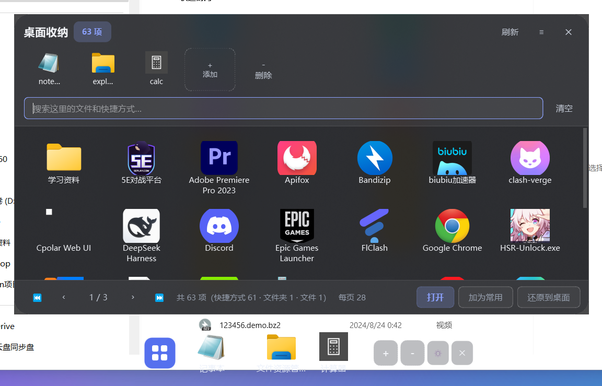
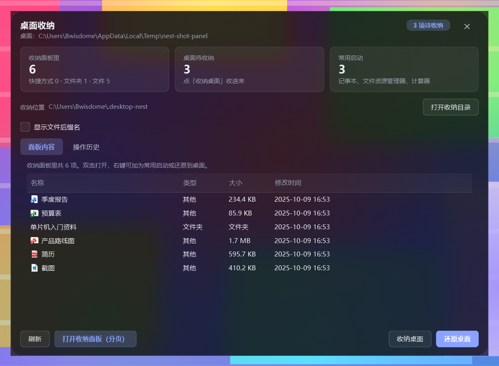

# 桌面收纳美化工具 · Desktop Nest

一个 Windows 桌面小工具，三件事：

1. **启动程序时自动把桌面收干净**——个人桌面 + 公共桌面上的文件、文件夹、快捷方式，连「此电脑」「回收站」这类系统图标一起收进隐藏目录，桌面彻底空白
2. **屏幕底部正中给一条仿 macOS 菜单栏**，点最左边的「桌面整理」就向上拉出一块**磨砂玻璃浮层**，分页浏览、搜索、打开收纳起来的东西
3. **退出程序时自动还原**，桌面回到你熟悉的样子

技术栈：**Python + PyQt6**（Win10 / Win11）。纯本地运行，不联网、不装服务、不上传任何东西。

---

## 快速开始

```
1. 双击  安装依赖.bat        （只需一次，装上 PyQt6）
2. 双击  创建快捷方式.bat     （可选：在桌面和开始菜单放一个带图标的快捷方式）
3. 双击  启动桌面收纳.bat     或双击桌面上的「桌面收纳」
```

> **关于 .exe**：程序是 Python 写的。想要一个真正的单文件 `.exe`，需要用
> PyInstaller 打包（见文末「打包成 exe」）。`创建快捷方式.bat` 提供的是**体验等价**的方案：
> 带图标、带名字、双击即启动、**不弹黑窗口**（走 `pythonw.exe`），
> 在开始菜单里还能搜索并固定到任务栏。

启动后会看到：
* 屏幕底部正中一条**菜单栏**
* 一个主面板（只在第一次运行时显示，之后静默驻留托盘）
* 桌面上的东西已经被收进收纳目录，桌面空了

> **个人桌面和公共桌面会一起收**。公共桌面
> （`C:\Users\Public\Desktop`）里的快捷方式会显示在**所有用户**的桌面上，
> 只收个人桌面是收不干净的，所以两个都收；还原时各自送回原处。

托盘图标在任务栏右下角（抽屉形状，可能被折叠进「^」溢出区）。
**左键单击** = 开关收纳面板；**双击** = 打开主面板。

---

## 底部菜单栏（Dock）


```
   没加常用软件时：  [▣ 桌面整理]   ＋  －  ⚙  ✕
   加了常用软件后：  [▣ 桌面整理] │ [记事本] [文件资源管理器] [计算器]   ＋  －  ⚙  ✕
                    └─────────────── 一行，没有底板，直接浮在桌面上 ───────────────┘
```

**底板是纯透明的**：没有那条深色圆角横条，只有「桌面整理」控件、常用启动图标
和 `＋ － ⚙ ✕` 四个小按钮浮在桌面上（图标名字用浅色，好在大多数壁纸上看清）。

菜单栏**只有这一行**。上方原来那排"分页条目"已经整行删掉了——
分页浏览收纳内容全部在**收纳面板**里完成（见下一节）。
控制按钮和图标**在同一行**：底板没了之后分两行会变成上下两撮图标各自浮着，很散。

| 位置 | 操作 |
| --- | --- |
| **第一个控件「桌面整理」** | **上拉 / 收起收纳面板**（分页 + 搜索 + 还原）；再点一次收起，等同托盘左键单击 |
| 常用启动项 | 图标 + 名称，单击直接启动；**长按左键可拖动排序**（见下）；右键出「打开 / 打开所在位置 / 左移 / 右移 / 从菜单栏移除」 |
| `＋` | **批量添加**：从收纳内容里**勾选多项**，或浏览文件选一个 |
| `－` | **批量删除**：勾选多项一次性移出常用启动（列表为空时自动变灰） |
| `⚙` | 打开设置 |
| `✕` | **隐藏整条菜单栏**。隐藏后从托盘右键菜单勾选「显示底部菜单栏」就能叫回来 |
| **按住拖** | **整条菜单栏沿屏幕底边左右移动**，位置记住（`dock_x`） |
| 空白处右键 | 打开桌面收纳面板 / 全部还原到桌面 / 图标大小 / 总在最前 / 打开主面板 / 设置 / 退出 |

> 隐藏整条菜单栏之后程序不会退：托盘图标仍在，右键菜单里能勾回来。
> 这个开关的状态会存进配置，重启后保持你上次的选择。

**常用启动加多了会自动换行**，菜单栏只会变宽变高到屏幕能容纳的程度，
**永远不会跑出屏幕**，图标也不会被挤扁。**删掉常用项后尺寸会立刻缩回去**，
不会在原地留一块空白。

> 透明底板的一个代价：图标底下没有暗色托着，浅色壁纸上的浅色元素会不容易看清。
> 所以悬停底色和 `＋ － ⚙ ✕` 用的是**中性半透明灰**（对浅色、深色壁纸都可辨），
> 而不是纯白（浅壁纸上消失）或纯黑（深壁上消失）。
> 想改回有底板的样式，只动 `theme.py` 里的 `#DockSurface` 一处即可。

### 鼠标三种手势怎么区分

菜单栏是**纯透明**的，视觉上整条都是"空白"，可实际上图标把能点的位置几乎铺满了。
所以三种意图这样分（`DockIcon` 负责判定并上报，`DockBar` 负责执行）：

| 动作 | 结果 |
| --- | --- |
| 按下后**原地松开** | 单击 → 启动（`DockIcon.activated`） |
| 按下后**很快**拖动（位移 > 6px，且没到长按时限） | **拖整条菜单栏**左右移动 |
| 按下**长按 320ms** 后再拖 | 对常用软件**排序**，松手即写回配置 |
| 按下长按后原地松开 | 什么都不做（不误启动——长按的意图是排序） |

> **为什么"按住图标快速拖"也算拖整条菜单栏**：底板透明之后，
> 图标加四个控制按钮把整条栏铺满了，只剩 8px 外边距能下手。
> 只让空白处可拖的话，用户根本找不到下手的地方——"菜单栏拖不动"就是这么来的。
>
> **长按时限取 320ms** 而不是 iOS 那种 500ms：鼠标点击很少超过 200ms，
> 320ms 既够"明确长按"，又不至于按得手酸。
>
> **拖动只沿底边走**：菜单栏是"贴底工具条"，纵向位置由 `reposition()` 统一管。
> 如果跟着鼠标上下跑，松手时又会被弹回底部，看起来像"拖到一半自己跳回去"。

排序时的反馈：被按住的图标保持"按下"样式（`#DockIcon:pressed`），
目标位置会出现一根**蓝底白边的竖线**（`#DockDropLine`），松手后图标就落到那里。


> 指示线的宽度给了 4px 而不是 2px：QSS 的 `border` 是画在控件**内部**的，
> 只给 2px 的话左右两条 1px 白边就把中间占满、蓝色一点都露不出来，只剩一根白棍。

### 这几轮修掉的几件事（都有回归用例）

| 现象 | 根因 | 修法 |
| --- | --- | --- |
| **菜单栏拖不动** | 只有 8px 外边距能拖，图标和控件把整条栏铺满了 | 图标上"按下即拖"也算拖整条栏；空白处照旧 |
| **入口和常用软件之间有一块"空白格"** | 应用区是**等宽网格**（`unit_size()` 取所有条目的最大宽度当格子宽），那根 1px 分隔线也会**占满一整格**（≈ 一个图标宽），看着就是一块空白格；而且入口没文字、比常用项窄，自己那格右侧还会空出一截 | **彻底不插分隔线**；再用 `DockIcon.set_min_width()` 把入口抬到和常用项一样宽。两者之间只剩布局的一个 spacing（实测 3px） |
| **打开软件后高光一直亮着** | 点完鼠标还停在图标上，Qt 不会补发 leave 事件，`WA_UnderMouse` 一直为真，`:hover` 那层底色就永远亮着 | 启动 / 点控制按钮后调 `widgets.clear_hover()`：清 `WA_UnderMouse` + `unpolish/polish` + `update()` |
| **不能手动排序常用软件** | 原来只有右键菜单的「左移 / 右移」，一次挪一格 | 长按拖动排序 + 插入指示线；配置层新增 `Config.move_to(from, to)`（`move_quick` 只能和邻居交换，做不了"任意位置落到任意位置"） |
| **图标清晰度太低** | `SHGetFileInfoW` 只有两档：LARGEICON 顶天 **32×32**，SMALLICON 16×16。菜单栏要显示 44 / 52、收纳面板要显示 48，等于把 32×32 硬拉大 | 新增 `icons.get_icon_best()`：`SHGetImageList(SHIL_JUMBO)` 拿 **256×256** 原图，再让 Qt 平滑缩到显示尺寸。**菜单栏和收纳面板都走这一档** |

> 顺带修掉一个潜在泄漏：`rebuild()` 每次都 `main_row.addStretch(1)`，
> 但清场时只摘控制按钮，**弹性占位项会越积越多**——每个都要占一份 spacing，
> 重建几十次之后菜单栏就会莫名其妙变宽。现在 `_clear_stretches()` 会先摘干净。

### 图标清晰度是怎么提上来的

```
  旧： SHGetFileInfoW(SHGFI_ICON|SHGFI_LARGEICON)  →  32×32  →  拉到 44 / 48 显示 = 糊
  新： SHGetFileInfoW(SHGFI_SYSICONINDEX) → 图标编号
       SHGetImageList(SHIL_JUMBO) → IImageList → GetIcon(i) → 256×256
       → 交给 Qt 平滑缩到 44 / 48 / 52 / 60（QIcon 内部用 SmoothTransformation）
```

走这一档的地方（`IconLoader.request(..., hi_res=True)`）：

* **菜单栏**：常用软件图标显示 44（可在设置里调到 28~80）；
* **收纳面板**：网格里的图标显示 48、顶部常用启动行显示 34。

> 收纳面板原来只写了 `ICON_REQUEST = 64`，可 `get_icon()` 顶天只给 32×32，
> 所以 48px 的格子其实是把 32 的图**拉大 1.5 倍**——照样糊。
> 现在这两处也带上了 `hi_res=True`，和菜单栏取同一张 256×256 原图。

主面板那种 16px 的列表小图标仍走 32px 档（2:1 下采样已经很清晰，省内存也省时间）。

`SHGFI_SYSICONINDEX` 拿到的编号在 16 / 32 / 48 / 256 各张系统图像列表里指的是**同一个图标**，
所以可以"要 32 的编号、取 256 的图"。取完必须 `IImageList::Release()`，否则每次调用都漏一个引用。

拿不到 jumbo（老系统、条目不存在）时**静默退回** `get_icon()`，行为跟改动前完全一致，
不会因为新路径失败而没图标。缓存键里带了 `256`，PNG 磁盘缓存一样命中。

「桌面整理」那个入口是**矢量画的**，所以改成预先画好 16 / 24 / 32 / 48 / 64 / 96 / 128 / 192 / 256
九档塞进一个 `QIcon`，让 Qt 按实际需要的尺寸挑——只画一张 48px 的话，换大图标或高 DPI 屏就会被拉糊。

> 一个观察：Shell 的 jumbo 图和 exe 资源段里的图标**不一定是同一张画**。
> 比如 `calc.exe`，资源段里是传统那张白框计算器，而 shell 解析出来的是
> Win11 计算器应用的深色方块图标。这里选的是 **shell 的 jumbo 图**——
> 跟资源管理器"超大图标"视图看到的一致。

### 两个只在"增删常用项"时才现形的坑（都已修 + 有回归）

* **加了个新常用软件，旧的图标全变成占位字母块。**
  `IconLoader.request()` 命中缓存时会**直接返回、不再发 ready 信号**，
  光靠"重建 + 重新排队"的话，重建出来的按钮会一直停在占位字母上——
  只有这次新加的那个（还没进缓存）才拿得到真图标。
  修法：重建时先查缓存，命中就**直接 `setIcon`**（和收纳面板同一套做法）。
* **删掉常用项，菜单栏的宽度不缩回去。**
  `FlowRow` 的行列数原来是从 `QGridLayout` 读的，而 `QGridLayout` 在
  `takeAt()` 之后**不会**把 `columnCount()` 收回去（实测删掉一项后 `_items`
  只剩 5 个，网格仍报 6 列），`sizeHint()` 于是一直按旧列数算。
  修法：`FlowRow` 自己记 `(columns, rows)`，`sizeHint()` / `minimumSizeHint()`
  只认这两个数，跟网格内部状态彻底解耦。
  顺带修掉一个同源问题：`unit_size()` 以前直接用 `sizeHint()`，
  而 `setFixedSize()` **不改 `sizeHint()`**，`DockIcon` 报出来的宽度比实际窄
  20 多像素，菜单栏因此比内容窄一截、最后一个图标被裁掉；
  现在按 `QWidgetItem` 的口径把 sizeHint 夹进 `[minimumSize, maximumSize]`。

---

## 收纳面板（贴底上滑的磨砂玻璃浮层）



点底栏的「桌面整理」，面板会从**屏幕底部正中向上拉出**；**再点一次就收起来**。
它不是那种弹出来、必须点 `✕` 才能关掉的应用窗口，也不是白色矩形弹窗，
而是一块**贴在底栏上方的半透明深色磨砂玻璃浮层**：

| 特性 | 说明 |
| --- | --- |
| **随时开合** | 底栏「桌面整理」、托盘**左键单击**都能开关；面板里按 `Esc` 也能收起 |
| **磨砂玻璃** | 背后是真的被模糊掉了（DWM 亚克力/模糊，见 `acrylic.py`），不是画上去的假半透明 |
| **深色半透明** | 底色恒定是深色半透明，**不跟明暗主题走**；绝对不会是纯白底 |
| **大圆角** | 22 px 圆角（和主面板同一套），窗口本体也按同一半径裁一刀，免得模糊糊到圆角外面 |
| **贴底弹出** | 固定在屏幕底部正中，底边正好落在**菜单栏顶边之上**（让开的高度按 Dock 的**实际高度**算，菜单栏变高也不会被压住）；屏幕小或面板大时自动压缩尺寸并夹住坐标，**不会跑出屏幕** |
| **无边框、不占任务栏** | `FramelessWindowHint + Tool`：没有标题栏，也不会在任务栏多出一个"应用" |
| **不能拖动** | 位置固定（省得拖丢、拖出屏幕）；**只有尺寸会被记住** |
| **不置顶** | 没有 `WindowStaysOnTopHint`，点别的程序它会正常让到后面 |

内容：

* **图标 + 下方名称**的网格显示
* **分页**：默认 7 列 × 4 行 = 28 个/页，底部 `⏮ ‹ 1/2 › ⏭`；也支持 `PageUp/PageDown`、`Ctrl+滚轮`
* **搜索**：实时模糊匹配；连续命中（如搜「文件0」→「文件00」）永远排在顺序命中（→「文件20」）前面
* 每页数量可调 14 / 21 / 28 / 35 / 42
* 顶部一排是**常用启动**（图标 + 名称），可加可删
* 选中后可「打开」「加为常用」「还原到桌面」；右键还有打开所在位置、复制路径、查看文件夹大小

> **打开 / 翻页这个面板，绝不会让底部菜单栏消失。** 面板就贴在菜单栏上方、
> 尺寸也盖得住菜单栏那一带，所以"自动避让"逻辑里专门排除了**本程序自己的窗口**
> （比窗口句柄 + 进程号）；面板开着的时候菜单栏也一律保持可见。

---

## 主面板（悬浮磨砂玻璃卡片）



托盘**双击**（或底栏右键 →「打开主面板」）打开的窗口，用来看全局、做决定。
它不是普通的白色矩形弹窗，而是一块**浮在桌面之上的半透明磨砂玻璃卡片**：

| 特性 | 说明 |
| --- | --- |
| **磨砂玻璃** | 背后是真的被模糊掉了，不是画上去的假半透明。由 DWM 的亚克力/模糊实现（`acrylic.py`），Win11 走亚克力、Win10 1803+ 走纯模糊、更老的系统自动退回"只有半透明、没有模糊" |
| **深色半透明** | 底色恒定是深色半透明（约 0.58），**不跟明暗主题走**——浅色主题下做成白底就没有玻璃味了 |
| **大圆角** | 22 px 圆角；窗口本体也按同一个半径裁一刀，免得模糊糊到圆角外面 |
| **无边框** | 没有系统标题栏；**按住卡片空白处就能拖走**，`Esc` 或右上角 `✕` 收起 |
| **不是对话框** | `FramelessWindowHint + Window`，浮在桌面图层之上，不是模态对话框 |

内容：三张统计卡片（收纳面板里 / 桌面待收纳 / 常用启动）、收纳位置、
**`显示文件后缀名` 开关**、`面板内容 / 操作历史` 两个标签页、
以及底部一排操作（刷新 / 打开收纳面板 / 收纳桌面 / 还原桌面）。操作历史里选中某条可以**原样撤回**。

> 主面板和收纳面板共用 `widgets.GlassCardMixin` 里的同一套外观逻辑
> （DWM 磨砂 + 圆角裁剪 + 深色调色板），改一处两边一起变。
>
> 三个只会在深色玻璃上暴露的坑，都写进代码注释了：
> 1. **顶层窗口不能自己设 QSS 背景**——设了就把磨砂整块盖住，看起来就是一块不透明的板子。
>    卡片外观一律交给子控件 `#MainCard`（主面板）和 `#Popup`（收纳面板）。
> 2. **`QTabWidget.setDocumentMode(True)` 会在标签栏顶上画一条"基线"**，那是原生样式用
>    **主题位图**画的，既不吃 QSS 也不吃调色板。浅色主题下看不出来，深色玻璃上就是一道刺眼的白。
>    解决办法是 `tabBar().setDrawBase(False)`。
> 3. **玻璃规则块必须放在整份样式表的最后**。放在中间的话，后面那些
>    `#Popup { background: … }` 之类的普通规则会把玻璃规则盖掉——
>    看起来"磨砂没生效"，其实是被后写的规则赢了。

---

## 底部菜单栏的行为细节

| 行为 | 说明 |
| --- | --- |
| **隐藏整条菜单栏** | 点 `✕`。这是"用户主动隐藏"，之后**不会**自动弹回来——尊重你的选择 |
| **回到桌面自动显示** | 切回桌面时菜单栏自己出来。托盘右键可关掉这项 |
| **只在最大化/全屏时让开** | 前台窗口**真的最大化**（浏览器、资源管理器）或**全屏**（看视频、演示）时才收起；普通窗口、窗口打开动画、桌面空闲**都不会**让它隐藏 |
| **防抖，不闪烁** | "要让开"和"要恢复"都必须**连续两次检测（约 2.4 秒）**成立才动作。切换程序、窗口动画、拖动窗口这类瞬时状态不会引起显隐抖动 |
| **桌面空闲不会消失** | 人在桌面上发呆多久都不会收——桌面前台被明确排除在"让开"之外 |
| **打开收纳面板时绝不让开** | 避让只响应**别的程序**的前台窗口状态。收纳面板是本程序自己的浮层，它开着（哪怕正在翻页、搜索）时菜单栏一律保持可见——这是"翻页时菜单栏时不时消失"的修复点 |
| **常用项多了会换行** | 加再多常用启动也只会让菜单栏变宽变高到屏幕能容纳的程度，**永远不会跑出屏幕**，图标也不会被挤扁 |
| **面板不置顶** | 收纳面板不会永远压在别的程序上面；点别的窗口它就正常让到后面 |

> 这几条的区别很重要：**自动显隐只在"你没主动关过"的前提下生效**。
> 你点过 `✕` 之后，程序不会自说自话把它弹回来——要用托盘菜单或
> 「回到桌面自动显示菜单栏」开关重新打开。
>
> 另外，自动显隐**只动窗口的可见性**，不会去改 `dock_visible` /
> `dock_hidden_by_user` 这些"显示/隐藏"状态变量——否则"打开面板"就会被误记成
> "用户把菜单栏关了"，之后再也自动弹不回来。

### 「让开」的判据是怎么定的

只认这几类窗口，**其余一律不让开**：

| 判据 | 阈值 | 为什么 |
| --- | --- | --- |
| 真全屏 | 宽高都 ≥ 显示器的 96% | 全屏看视频、演示 |
| 最大化 | 面积 ≥ 工作区 80% **且** 高 ≥ 90% | 实测 1920×1080 上最大化的 Chrome 是 **1619×1036**（宽度只占 84%），按"宽高都接近 100%"判会漏 |
| 接近满宽 | 宽 ≥ 显示器 98% **且** 高 ≥ 工作区 94% | 补住"宽到几乎铺满、但面积还没到 80%"的那种窗口 |

早期版本还有一条"窗口盖住了菜单栏那一带就让开"。这条**已经删掉**：
普通窗口拖到屏幕底部、窗口打开动画的中间帧都会短暂满足它，结果就是
"打开非全屏软件时菜单栏疯狂闪现"。现在竖直/宽扁的条状窗口都明确不让开。

> 判据不用 `IsZoomed()`。Chrome 这类自绘标题栏的程序最大化后并不设置
> `WS_MAXIMIZE`，`IsZoomed` 一直返回 0——量外框尺寸才准。

---

## 常用启动：批量添加 / 批量删除

菜单栏和收纳面板上的 `＋` / `－` 是一对：

| 按钮 | 行为 |
| --- | --- |
| `＋` → **从下面的列表里选…** | 弹出**复选框列表**，勾选**多项**后一次加入。已经是常用的项不会再列出来，避免勾了没反应 |
| `＋` → **浏览文件…** | 挑单个程序 / 快捷方式 / 批处理加进去 |
| `－` | 弹出同样样式的复选框列表，勾选多项**一次性移除**（只动菜单栏这一排，不碰文件） |

弹窗里还有「全选 / 全不选」，底部实时显示"已选 N 项"，没勾选时确认按钮是灰的。
常用启动为空时 `－` 会自动变灰。

**增删之后配置和界面是同步的**：先改配置（批量操作只写一次盘，避免出现
"加了新的、旧的却没了"的中间态），再重建这一排，最后才发信号通知其它界面刷新。
顺序反了就会读到中间态——这是"数据与 UI 不同步"的修复点。

---

## 显示文件后缀名

主面板和设置窗口里都有一个 **`显示文件后缀名`** 开关，**默认关闭**。

| 开关 | 界面显示 | 磁盘上的文件 |
| --- | --- | --- |
| **关闭（默认）** | `报告.docx` 显示成 **`报告`**；文件夹（`资料夹`、`v1.2`）不受影响 | **完全不变** |
| **打开** | `报告.docx` 显示成 `报告.docx` | **完全不变** |

* **只改界面上的文字**，磁盘上的真实文件名一个字都不会动；
  收纳 / 还原 / 撤销等操作走的始终是真实路径（显示名只用于列表和网格）。
* **搜索两种写法都能命中**：不管开关开着还是关着，搜 `报告` 或 `报告.docx` 都能找到这个文件。
* **配置持久化**：选择存进 `config.json` 的 `show_extensions`，重启后保持。
* 设置窗口（底栏 `⚙` / 托盘菜单「设置」）里也能改，改完主面板与收纳面板会一起刷新。

---

## 收纳行为（核心）

```
启动程序                                    退出程序
   │                                          │
   ├─ 个人桌面 ──┐                            ├─ → 个人桌面
   ├─ 公共桌面 ──┴─→ 收纳目录                 ├─ → 公共桌面（各回各家）
   ├─ 隐藏桌面图标（桌面彻底空白）              ├─ 恢复桌面图标
   └─ 建 此电脑/回收站 等系统快捷方式           └─ 收纳目录清空
```

三件事都在设置里可以单独关掉。

### 文件夹是整体搬走的

桌面上的**文件夹作为一个整体**进收纳目录，里面内容原样保留，不会拆到顶层：

```
整理前桌面                     收纳后
├── 单片机入门资料/      →     ├── 单片机入门资料/
│   ├── 第一章/                  │   ├── 第一章/
│   │   └── 笔记.txt             │   │   └── 笔记.txt
│   └── 说明.txt                 │   └── 说明.txt
└── 报告.docx            →     └── 报告.docx
```

### 公共桌面也会一起收

`C:\Users\Public\Desktop` 里的快捷方式会显示在**所有用户**的桌面上。
只收个人桌面的话，这一批会一直留在桌面上，所以两个桌面都收：

| 情况 | 处理 |
| --- | --- |
| 公共桌面的快捷方式 | 一并收进收纳面板，**还原时送回公共桌面**（不会挪到你个人桌面） |
| 两边同名的（如都有 `记事本.lnk`） | 公共那份收进来时加后缀 `记事本（公用）.lnk`，避免互相覆盖；还原时自动去掉后缀 |
| 公共桌面没写权限 | 那个条目会**退回个人桌面**并在结果里说明，不会把文件卡住或弄丢 |
| 缺失 `desktop.ini` | 系统文件，始终跳过 |

> 注意：写入 `C:\Users\Public\Desktop` 有时需要管理员权限。如果你的账号没有，
> 收纳这一步会失败并被记录下来，**文件不会丢**——程序会明确告诉你哪些没成功。
### 「此电脑」「回收站」也会被收进去

这两个不是文件系统里的东西（没有路径），程序用 Windows 的 `IShellLinkW` 接口生成
指向 `::{CLSID}` 的快捷方式放进收纳目录，于是在面板里能看到、能点开，
桌面本身则一个图标都不剩。生成的是标准快捷方式，双击由资源管理器打开。

### 收纳目录在哪

```
C:\Users\<你>\.desktop-nest\
├── desktop\      ← 两个桌面上原来的东西
├── links\        ← 此电脑 / 回收站 / 网络 / 用户文件夹 的快捷方式
├── links.json    ← 名称 → shell 位置的对照表
└── sources.json  ← 每个条目原来在个人桌面还是公共桌面（决定还原去哪）
```

是隐藏目录，平时不用管。想看看就点主面板的「打开收纳目录」。

---

## 搜索

置顶搜索框，输入即时过滤：

* **连续子串优先**（含前缀）：搜「报告」命中「季度报告.docx」
* **顺序匹配兜底**：搜 `gch` 也能命中 `Google Chrome`，但**永远排在连续命中之后**
* **跟后缀开关无关**：搜原名（`报告.docx`）和搜不带后缀的名字（`报告`）都能命中同一个文件
* 结果自动收拢到一页
* 清空（点「清空」或按 `Esc`）立刻恢复全部

---

## 安全设计

| 机制 | 说明 |
| --- | --- |
| **只移动，绝不删除** | 全程没有任何删除文件的代码路径 |
| **绝不覆盖** | 目标重名自动加 `(1)`、`(2)` 后缀 |
| **跨盘安全搬运** | 同分区用 `os.replace`（原子改名）；跨分区改为「复制 → 校验大小 → 删源」，最坏情况是留下重复文件，不会丢文件 |
| **系统项保护** | `desktop.ini`、`Thumbs.db`、隐藏文件、`~$` 临时文件、`.crdownload` 半成品一律不动 |
| **失败可解释** | 被独占占用时预判为跳过并说明原因；只读文件正常收纳、不会误判 |
| **退出必还原** | 即使异常退出，下次启动也会先把上次没收完的还原回去 |
| **崩溃也还原** | 见下一节「崩溃兜底」——任何未捕获异常都会**先把桌面还回去**再退出 |
| **全程可撤销** | 每次收纳 / 还原都写一条 JSONL 流水；主面板「操作历史」里选中某条即可**原样撤回**（逆序搬回），也可以清空历史 |
| **逆序撤销** | 一次操作里可能出现「A 搬到 B、B 又被改名」这类链式变化，倒着搬才能让每个条目回到它当时的位置 |

### 崩溃兜底：程序炸了也要先把桌面还给你

程序会把桌面文件**暂存在收纳目录**里，正常退出时还原。风险窗口很明确：
**"已经收纳完、还没还原"** 这段时间如果程序崩了，用户看到的就是一个空桌面
（哪怕文件其实都还在）。

所以 `install_crash_guards()` 挂了三层钩子，任何一层发现异常，第一件事都是把
桌面还原回去：

| 覆盖路径 | 钩子 |
| --- | --- |
| 主线程未捕获异常 | `sys.excepthook` |
| 子线程未捕获异常（扫描线程就属于这类） | `threading.excepthook` |
| Qt 事件循环里抛出的异常 | `app.exec()` 外层的 `try/except/finally`，外加 `finally` 兜一次 |

真正干活的 `emergency_restore()` 有几个刻意设计：

* **绝不弹窗**——崩溃路径上再弹模态框就是二次事故；
* **绝不抛异常**——它自己炸了就没兜底了，整体 `try/except` 包住；
* **可重入**——退出流程和异常钩子可能都调它，用标志位保证只跑一次；
* **尊重用户设置**——用户明确关掉「退出自动还原」时它不动手。

此外 [main.py](main.py) 用 `faulthandler` 把**原生崩溃**（Qt/Windows 那种直接
abort 的）也记进 `crash.log`——这种崩溃 Python 的 `try/except` 抓不到，
现象就是"双击毫无反应"，必须靠它才能定位。

---

## 边界与异常处理

| 情况 | 表现 |
| --- | --- |
| 文件被独占占用 | 标为跳过并说明原因，不强行搬 |
| 只读文件 | 照常收纳（不会误报成"被占用"） |
| 权限被拒 | 提示「所在文件夹不可写（可能需要管理员权限）」 |
| 收纳目录不可写 | 自动退到程序目录下的 `.desktop-nest` |
| 隐藏桌面图标失败 | 记日志，不影响收纳本身，仍可手动在桌面右键切换 |
| 快捷方式解析失败 | 退回显示 Shell 类型图标，不报错、不崩溃 |
| 开机自启写不进去 | 自动改用「开始菜单 → 启动」文件夹；都失败则提示手动方式 |
| 意外异常 | 后台线程兜底捕获 + 写日志到 `.data\app.log` |

---

## 文件结构

```
desktop-nest\
├── 启动桌面收纳.bat        启动器（自动挑一个能用的 Python）
├── 创建快捷方式.bat        在桌面/开始菜单放一个带图标的快捷方式
├── 还原桌面.bat            应急：把收纳目录里的东西全部搬回桌面
├── 修复公共桌面.bat        把公共桌面的快捷方式送回去（需管理员）
├── 安装依赖.bat            一键安装 PyQt6
├── create_shortcut.py      上面那个快捷方式脚本的实现
├── restore_desktop.py      应急还原的实现
├── fix_public_desktop.py   公共桌面修复的实现
├── app.ico                 程序图标（快捷方式/打包都用它）
├── main.py                 入口
├── config.py               配置持久化 / 路径工具 / 开机自启
├── tray_app.py             托盘常驻 / 启动收纳 / 退出还原 / 后台扫描
├── nest.py                 收纳目录管理：搬运、系统位置快捷方式、图标开关、**操作流水与撤销**
├── winlink.py              .lnk **创建**（COM IShellLinkW，虚表下标实测过）
├── dock.py                 底部菜单栏（纯透明单行：桌面整理 / 常用启动 / ＋ / － / ⚙ / ✕；可拖可排序）
├── desktop_browser.py      收纳面板（贴底上滑的磨砂玻璃浮层：分页网格 + 搜索 + 常用启动行）
├── panel.py                主面板（悬浮磨砂玻璃卡片：统计卡片 + 内容列表 + 操作历史 + 后缀开关）
├── acrylic.py              Windows 磨砂玻璃（DWM 亚克力/模糊 + 圆角裁剪）
├── settings.py             设置窗口
├── engine.py               条目类型、显示名（后缀开关）、图标解析、快捷方式二进制解析（[MS-SHLLINK]）
├── safety.py               安全校验：系统项、占用、路径包含
├── icons.py                Windows Shell 图标提取 + 缓存（32px 档 / 256px 高清档）
├── textutil.py             模糊搜索与高亮区间
├── widgets.py              共用零件：图标加载器、应用图标、`GlassCardMixin`（两张玻璃卡片共用外观）
├── theme.py                配色与整份 QSS（含 `GLASS` 玻璃配色）
├── qt_compat.py            Qt 加载器（自带 libs 优先）
├── setup_libs.py           直接下载解包 PyQt6（pip 不可用时的备用方案）
├── 桌面收纳.spec            PyInstaller 打包脚本（见文末「打包成 exe」）
├── requirements.txt        运行依赖（PyQt6）
├── .gitignore / .gitattributes  版本管理：忽略大件与运行期数据、统一换行符
├── libs\                   自带 Qt 运行库（约 215 MB，可删）
├── shots\                  README 用的截图
├── dev\                    自检脚本（`run_all.py` 可一次跑完全部；`shot_panel.py` 重拍四张界面截图）
└── .data\                  运行期数据：config.json / journal.jsonl / app.log
```

### 关于 `libs\` 这 215 MB

里面是 PyQt6 + Qt6 运行库。留着换台机器、换个 Python 都能直接跑；
想省空间可以删掉，再跑一次 `安装依赖.bat` 把 PyQt6 装进系统 Python。

> 注意：`libs\` 里带的是 **CPython 3.12** 的 ABI（`sip.cp312-win_amd64.pyd`）。
> 用别的 Python 版本（比如 3.13）直接跑会 `ModuleNotFoundError: No module named 'PyQt6.sip'`。
> `dev\run_all.py` 会自动探测一个能加载 PyQt6 的解释器，省得踩这个坑。

### 版本管理（git）

项目已纳入 git。**大件和运行期数据不进仓库**，规则都在 `.gitignore` 里：

| 忽略 | 原因 |
| --- | --- |
| `libs/`（约 215 MB） | 可用 `安装依赖.bat` 重新生成 |
| `dist/` `dist-new/` `build/` | 打包产物，随时可重建 |
| `.data/` `.desktop-nest/` `.icon-cache/` | 运行期生成：配置、流水、日志、图标缓存 |
| `*.log` `selftest-result.txt` | 本地排查用的临时文件 |

`.gitattributes` 统一了换行符：**源码固定 LF**（`* text=auto eol=lf`，工作区就是 LF，
git 不会再反复"预告"要改写成 CRLF）；**批处理 / PowerShell 固定 CRLF**——
LF-only 的 `.bat` 在 `goto` / 多行块里可能直接跑飞，这个不是洁癖问题。

---

## 快捷键

| 位置 | 按键 | 作用 |
| --- | --- | --- |
| 收纳面板 | `Ctrl+F` | 聚焦搜索框 |
| 收纳面板 | `Esc` | 有搜索词时清空；否则隐藏窗口 |
| 收纳面板 | `← →` | 在图标间移动 |
| 收纳面板 | `Enter` | 打开选中项 |
| 收纳面板 | `PageUp / PageDown` | 翻页 |
| 收纳面板 | `Ctrl+滚轮` | 翻页 |
| 托盘图标 | 左键单击 / 双击 | 开关收纳面板 / 打开主面板 |

---

## 高分屏 / 显示效果

程序按下面几点保证在 125% / 150% 缩放的屏幕上显示正常：

* 字体用 **pt（点）** 而不是 px —— 像素字号不随系统 DPI 缩放，
  结果就是别的东西都变大了、只有文字还是那么小
* 图标按控件实际的 `devicePixelRatio` 请求物理像素再缩回来，
  避免直接放大导致发虚
* **底栏图标按钮的宽度按文字实测宽度算**（`QFontMetrics`），不写死像素——
  否则字号跟着 DPI 放大、写死的宽度不变，125% 缩放下「任务管理器」这类名字
  会跟相邻项叠在一起
* **菜单栏排版用的是控件的"实际尺寸"**，不是 `sizeHint()`——
  `setFixedSize()` 只改 min/max、**不改 `sizeHint()`**，照后者排版，
  菜单栏会比内容窄一截、最后一个图标被裁掉（详见「底部菜单栏」一节）
* 窗口图标提供 16 ~ 256 共 7 种尺寸，小图标位上也不会糊
* **菜单栏和收纳面板的图标都走 256×256 的高清档**（`icons.get_icon_best()`），
  再让 Qt 按当前 DPI 平滑缩到显示尺寸。这条比"按 `devicePixelRatio` 放大位图"
  更省事也更稳：源图足够大，Qt 缩放到任何物理尺寸都清晰。
  主面板那种一次几百个 16px 小图标的列表仍走 32px 档，省内存也省时间
  （`IconLoader.request(..., hi_res=True)` 是显式的开关，不是全局改行为）
* **两张玻璃卡片（主面板 / 收纳面板）的圆角裁剪都要自己乘 `devicePixelRatio`**——
  `SetWindowRgn` 收的是物理像素，而 Qt 的 `width()/height()` 是逻辑像素。
  漏乘的话 125% 缩放下窗口会被裁小一圈，右下角连按钮都显示不出来
  （dpr=1 的机器上完全正常，所以这条专门写了自检）。
  换算抽成了 `acrylic.region_metrics()` 这个纯函数，`dev/test_panel_glass.py` 直接钉住它

> 如果看着还是偏小或偏大，可以在「设置 → 外观与启动」里调图标大小；
> 字体跟随系统缩放，不用额外设定。

---

## 应急还原（万一桌面上什么都没了）

正常情况下退出程序就会自动还原。如果程序被强制结束、或者你不放心，
项目里有三个现成的工具：

| 工具 | 用途 |
| --- | --- |
| `还原桌面.bat` | **双击即可**。把收纳目录里的东西全部搬回桌面，公共桌面的送回公共桌面 |
| `重启程序.bat`（即 `启动桌面收纳.bat`） | 程序启动时会先 `recover_leftovers()` 把上次残留还原，再重新收纳 |
| `修复公共桌面.bat` | 如果公共桌面的快捷方式落在了个人桌面，**右键以管理员身份运行**送回去 |

收纳目录固定在：

```
C:\Users\<你>\.desktop-nest\desktop     ← 你的文件都在这（找不到就从程序目录找）
```

这两个脚本都**只移动、不删除**，重名自动加序号。任何时候都可以直接去这个目录
把文件手动拷回来——它是普通文件夹，程序只是负责搬运。
## 打包成 exe

程序本身是 Python，要真正的 `.exe` 需要打包一次。项目里已经写好打包脚本
`桌面收纳.spec`，**别再手敲命令行**（手敲很容易踩到下面第 1 条坑）：

```bat
:: 1. 装打包工具（装进系统 Python 即可）
python -m pip install pyinstaller

:: 2. 在项目目录里打包（用 spec，所有关键设置都在里面）
pyinstaller 桌面收纳.spec --noconfirm

:: 产物：dist\桌面收纳\桌面收纳.exe
::       —— 整个 dist\桌面收纳 目录要一起拷走，不能只拿 exe
```

`桌面收纳.spec` 里已经处理好的事（都是踩过的坑）：

1. **`datas` 不塞 `libs/`**。`libs/` 是开发用的自带 PyQt6（约 215 MB），打包时完全不需要
   ——PyInstaller 会从 site-packages 正确收集 PyQt6 和 Qt6 平台插件。塞进去只会多出一整套
   重复的 Qt6 DLL（之前成品 **515 MB**，就是这个原因）。
2. **`upx=False`**。被压缩过的 Qt DLL 容易被杀软误报，也可能触发 Windows 完整性检查导致进程直接 abort。
3. **`console=False`**。正式版不弹黑窗口；出错时 `main.py` 会自己写日志并弹提示框，
   所以不会出现"双击没反应又看不到原因"。
4. **不打包运行期目录**。`.data` / `.desktop-nest` / `.icon-cache` 都是运行时生成的，
   打进去会导致"配置被固化"。
5. **`excludes` 剔掉用不到的大件**（QtWebEngine、QtQuick、tkinter、numpy…），能省下几百 MB。

几点提醒：

* 产物是 **onedir**（一个目录 + 一个 exe），不是单文件——启动更快，也不会有单文件版
  每次运行先解压一遍的等待。
* `app.ico` 已经生成好了，可以直接用；想换图标替换这个文件即可。
* 打包后第一次运行请**先在沙盒目录里试一遍**（设置里把桌面指到临时目录），
  确认收纳 / 还原都正常再正式用。
* 打包版和脚本版**共用同一份配置**（`~\.desktop-nest\` 与 `.data\`），可以随时互换。
## 开发者：自检脚本

**推荐：一键跑完全部**

```bat
python dev\run_all.py              :: 自动挑一个能加载 PyQt6 的解释器，九套依次跑完并汇总
python dev\run_all.py --list       :: 只列出会跑哪些用例
python dev\run_all.py --shots      :: 顺带让 test_nest 把界面截图存到 shots\
python dev\run_all.py --python <解释器路径>   :: 手动指定解释器
python dev\run_all.py test_core test_nest     :: 只跑名字里含这些关键字的几套
```

全部通过时退出码为 `0`，任何一套失败为 `1`，方便挂到批处理或 CI 上。

也可以单独跑某一套（括号里是实测项数）：

```bat
python dev\test_core.py          :: 快捷方式创建+二进制解析 / 安全校验 / 模糊搜索（42）
python dev\test_move.py          :: 搬运安全性与失败回滚（13）
python dev\test_icons_page.py    :: 翻页后图标不消失（11）
python dev\test_dock_fixes.py    :: 启动崩溃 / 常用图标 / 高亮 / 显隐 / 玻璃浮层 / 翻页时 Dock 不消失 / 单行透明底板 / 应用区不留空白格 / 整条可拖 / 高光随点随消 / 长按拖动排序 / 菜单栏与收纳面板图标取 256×256（103）
python dev\test_round3.py        :: 常用图标 / 不跑出屏幕 / 窗口图标 / DPI 字体 / 让开判据（24）
python dev\test_quick_apps.py    :: 常用软件：图标 / 增删同步 / 不留空白 / 持久化 + Dock 加新项图标不丢、删项尺寸缩回、纯透明底板（34）
python dev\test_iteration.py     :: 右键菜单不崩 / 崩溃自动还原 / 批量增删 / Dock 只对最大化避让 + 防抖（44）
python dev\test_panel_glass.py   :: 两张玻璃卡片：高 DPI 圆角裁剪 / 标签栏白线 / 共用 mixin / 回退（49）
python dev\test_nest.py --shots  :: 收纳主流程 / 两个桌面 / 分页 / 后缀开关 / Dock 稳定性 / 启动收纳退出还原（114）
```

九套共 **434 项检查**，都只在临时沙盒目录里操作，**不会碰真实桌面**。
`--shots` 会把界面截图存到 `shots\`。

> 「让开判据」那一条会读当前真实的前台窗口，所以它是**按实现里的规则复算期望值**
> 再比对，而不是硬编码一个面积阈值——否则前台窗口占比落在阈值中间区间时必然误报。

> `test_iteration.py` 里测"防抖"那一段会**先接管** `_foreground_is_fullscreen`。
> 因为跑测试时真实前台窗口很可能就是最大化的浏览器（本机实测 1619×1036、覆盖 81%），
> 不接管的话 dock 会被正常地藏起来，"起点可见"这个前提就不成立。

> 多选弹窗的**测试注入点**是 `browser._ask_multi` / `dock._ask_multi`，
> 不是 `widgets.multi_pick`。因为这两个模块是 `from widgets import multi_pick`
> **按值导入**的，改源头对它们不生效——真去改就会弹出模态窗把测试挂死。

> `test_panel_glass.py` 的像素扫描会在**没有字体**的环境里自动跳过：那种环境下
> 文字渲染成实心方块，整行会被误判成"横贯的不透明浅色线"。
> 这条断言只在有字体时才有意义（已在上一版代码上复现过同样的假阳性）。

> `test_panel_glass.py` 里有两条是专门盯"只有真机上才看得见"的坑：高 DPI 下窗口被裁小、
> 以及深色玻璃上那条标签栏白线。前者靠 `acrylic.region_metrics()` 这个纯函数钉死换算，
> 后者直接渲染一遍、扫描"横贯全宽的不透明浅色行"。

> `test_nest.py` / `test_dock_fixes.py` 里各有一组「Dock 不会消失」的回归：
> 把本程序自己的窗口冒充成前台窗口，确认避让判据**不会**把它当成"别的程序在遮挡菜单栏"，
> 再反复翻页、换每页数量，检查菜单栏始终可见、且"显示/隐藏"状态变量没被篡改。

辅助脚本（排查用）：

```bat
python winlink.py                  :: 实机验证快捷方式**创建**（写一个 .lnk 再解析回来）
python dev\probe_vtable.py         :: 实测 IShellLinkW 虚表下标（用官方 COM 对账）
python dev\read_lnk.ps1            :: 用 Windows 官方 WScript.Shell 读 .lnk 属性（给上面两个对账用）
python dev\shot_panel.py           :: 重拍四张界面截图（磨砂是 DWM 做的，必须真显示窗口再截屏）
```

> `dev\shot_panel.py` 为什么要"真显示再截屏"：磨砂模糊发生在 **DWM 合成阶段**，
> Qt 自己 `grab()` 出来的图里**没有模糊**。所以脚本会先摆一块高对比背景板，
> 把窗口真显示出来，再截整屏裁出面板——主面板存成 `shots/panel-main.png`，
> 菜单栏存成 `shots/dock.png`，长按拖动排序（插入指示线）存成 `shots/dock-reorder.png`，
> 收纳面板 + 菜单栏存成 `shots/popup-glass.png`。
>
> `dock-reorder.png` 是**模拟鼠标事件**拍出来的：按下第一个常用图标 → 等长按计时器
> （320ms）到点 → 把光标挪到第三个图标上 → 截屏。拍完再把光标挪回原处松手，
> 这样目标槽位等于原槽位、顺序不变，不影响后面那张截图。
>
> `test_nest.py --shots` 也会截图，但那是**离屏渲染**（没有磨砂模糊），
> 所以文件名带 `offscreen-` 前缀，不会覆盖上面这四张。

### 关于 COM 虚表下标（不要凭记忆猜）

`IShellLinkW` 的虚表顺序猜错不会报错，只会静默把数据写到别的属性上
（开发过程中就出现过"说明"被写进"参数"、生成一堆怪快捷方式的问题）。
所以这些下标都是**实测**出来的，验证方式见 `dev\probe_vtable.py`：
逐个下标写标记值，再用 Windows 官方的 `WScript.Shell` 读回来对账。

写入侧只走 `winlink.py` 一处（`_ShellLink` 里那几个下标是唯一定义，
开机自启的快捷方式也复用它，不另抄一份）。

**读取侧干脆不用 COM**：`IShellLinkW::GetArguments` 在 ctypes 直连虚表时返回 `E_INVALIDARG`
（写入侧正常、官方 COM 也能读到），踩过一次就不想再踩。现在读目标路径统一走
`engine.resolve_shortcut_target()`——直接按 `[MS-SHLLINK]` 规范解析 `.lnk` 的二进制结构，
不依赖 COM，也不会因为虚表下标错位而静默读错。判断"这是不是系统位置"则用程序自己维护的
`links.json` 清单，见 `nest.shell_path_for()`。

---

## 已知边界

* **系统托盘**：如果系统禁用了通知区域，程序会记日志并直接显示主面板。
* **开机自启**：写的是当前用户的 `HKCU\...\Run`（不需要管理员）。被安全软件拦截时会改用「启动」文件夹。
* **隐藏桌面图标**：走的是 Explorer 的 `HideIcons` 设置，等同桌面右键「查看 → 显示桌面图标」。
* **指向商店应用（UWP）的快捷方式**没有普通文件路径，会退回显示类型图标。
* 收纳目录**不能设在桌面里面**，程序会主动拒绝——否则会自己搬自己。
